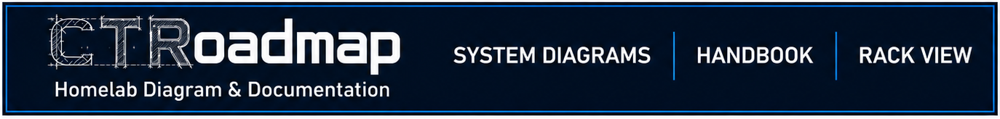

<p align="center">
  <a href="https://github.com/NoobCity99/CTRoadmap/stargazers">
    
  </a>
  <a href="https://github.com/NoobCity99/CTRoadmap/pkgs/container/ctroadmap">
    
  </a>
</p>

<p align="center">
  
  


</p>

<p align="center">
  <strong>LANGUAGE:</strong>
  <a href="README.md"></a>
  <a href="README.es.md"></a>
  <a href="README.it.md"></a>
</p>

<p align="center">
  <a href="#instalación-de-la-beta-con-docker"><strong>INSTALACIÓN</strong></a>
  &nbsp;&nbsp; | &nbsp;&nbsp;
  <a href="#funciones"><strong>FUNCIONES</strong></a>
  &nbsp;&nbsp; | &nbsp;&nbsp;
  <a href="#desarrollo"><strong>DESARROLLO</strong></a>
</p>

CTRoadmap es una herramienta autoalojada para crear diagramas y documentar tu **LABORATORIO DOMÉSTICO** mediante nodos, servicios, almacenamiento, scripts, configuraciones, URL y relaciones operativas. CTR busca ir un paso más allá de PowerPoint y otras aplicaciones de *diagramación*. Por diseño, es un repositorio independiente, SIN INTEGRACIÓN con el sistema que documenta. No supervisa ni controla tu laboratorio. Solo lo documenta. Es una aplicación web que se sirve desde Docker, se usa en el navegador y guarda la documentación de tu sistema en un archivo atlas.json.

CTRoadmap sigue siendo una aplicación de documentación que prioriza el trabajo en local. No es una plataforma de supervisión ni de control remoto. Su **NUEVA** herramienta opcional de **instantáneas del sistema** recopila información de la infraestructura en modo de solo lectura y únicamente cuando decides ejecutarla en tu host Linux. La aplicación web no inicia escaneos ni añade automáticamente al Atlas los elementos detectados. Tú revisas y apruebas los cambios propuestos antes de que se guarden.


<table>
  <tr>
    <td></td>
    <td></td>
  </tr>
  <tr>
    <td></td>
    <td></td>
  </tr>
</table>

## Instalación de la beta con Docker

Para una instalación estándar en Linux, **utiliza el siguiente instalador de CTRoadmap**. Configura tanto la aplicación Docker como los componentes del host necesarios para las actualizaciones y las instantáneas del sistema.

### Instalación estándar en Linux con Docker

Requisitos:

- Servidor Linux
- Docker
- Docker Compose v2
- `curl`
- Bash, `sha256sum`, utilidades estándar de Linux y certificados de autoridades de certificación (CA)
- Puerto 8088 accesible si se utiliza CTRoadmap desde otro equipo

Instalación recomendada:

```bash
curl -fsSL https://raw.githubusercontent.com/NoobCity99/CTRoadmap/main/CTR_install.sh -o CTR_install.sh
chmod +x CTR_install.sh
./CTR_install.sh
```

El instalador descarga y verifica `ctr_update.sh`, el actualizador de confianza que se ejecuta en el host, y le delega la instalación. El actualizador prepara los directorios de la aplicación, instala las utilidades de instantáneas, configura Docker Compose, inicia CTRoadmap y comprueba que la aplicación funcione correctamente. **Durante la instalación no se escanea la red.**

Instalación en una sola línea:

```bash
curl -fsSL https://raw.githubusercontent.com/NoobCity99/CTRoadmap/main/CTR_install.sh | bash
```

Directorio de instalación personalizado:

```bash
CTR_INSTALL_DIR=/opt/ctroadmap-beta ./CTR_install.sh
```

Después de la instalación, abre:

```text
http://YOUR-SERVER-IP:8088
```

El directorio de instalación predeterminado es:

```text
~/ctroadmap-beta
```

**Cómo funciona:** El instalador despliega la imagen Docker oficial de la beta de CTRoadmap:

```text
ghcr.io/noobcity99/ctroadmap:beta
```

Para una instalación estándar en Linux, **no** necesitas clonar este repositorio ni instalar por tu cuenta Python, Node.js, npm o WhosThere. El instalador y el actualizador del host se encargan de los componentes necesarios para la aplicación y las instantáneas.

### Compatibilidad con AMD64 y ARM64 (novedad de v0.9)

Desde **v0.9.0-beta**, CTRoadmap funciona en sistemas Linux tanto **AMD64 (x86-64)** como **ARM64 (ARM de 64 bits)**. Esto amplía la compatibilidad a servidores domésticos basados en ARM, ordenadores de placa única y dispositivos NAS compatibles.

La imagen Docker oficial admite ambas arquitecturas con la misma etiqueta `:beta`. Docker selecciona automáticamente la versión adecuada para tu sistema, por lo que **no necesitas una descarga, una etiqueta de imagen ni un procedimiento de instalación distintos**.

En las instalaciones estándar de Linux, el instalador de CTRoadmap y el actualizador del host también instalan las utilidades de instantáneas correspondientes a la arquitectura del equipo. Si utilizas un NAS o Portainer, sigue los procedimientos habituales de despliegue y actualización de tu plataforma.

### Instalación en Synology, NAS o Portainer

También puedes desplegar CTRoadmap en entornos Docker gestionados desde un NAS o con Portainer.

Estas plataformas tienen sus propios procedimientos de instalación y gestión de contenedores, por lo que este README no repite sus instrucciones de configuración. Descargar o actualizar la imagen Docker desde un NAS o Portainer **no** instala ni registra el actualizador del host Linux de CTRoadmap ni las herramientas de instantáneas. En esta beta, la función de instantáneas del sistema no está disponible con el método de actualización Platform / NAS Managed.

Para consultar las instrucciones de instalación en un NAS o con Portainer, visita:

**https://mariushosting.com/?s=ctroadmap**

### Comandos habituales de administración

Para la instalación predeterminada en Linux:

```bash
cd ~/ctroadmap-beta
docker compose logs -f
docker compose down
docker compose up -d
./ctr_update.sh
```

Si instalaste CTRoadmap en otra ubicación, utiliza el directorio de esa instalación.

### Desinstalación

```bash
curl -fsSL https://raw.githubusercontent.com/NoobCity99/CTRoadmap/main/CTR_uninstall.sh -o CTR_uninstall.sh
chmod +x CTR_uninstall.sh
./CTR_uninstall.sh
```

De forma predeterminada, el desinstalador detiene CTRoadmap y conserva tanto la instalación como los datos persistentes.

Para una instalación personalizada:

```bash
CTR_INSTALL_DIR='/absolute/install/path' bash ./CTR_uninstall.sh
```

Para confirmar expresamente la eliminación completa, escribe:

```text
DELETE
```

Antes de elegir la eliminación completa, haz una copia de seguridad de todo lo que quieras conservar.

<details>
<summary><strong>Detalles de la desinstalación y la recuperación</strong></summary>

Antes de borrar nada, el desinstalador verifica la instalación concreta de CTRoadmap. Primero intenta una eliminación normal y solo utiliza `sudo` si quedan archivos protegidos creados por el contenedor.

Si la configuración de Compose falta o está dañada, se puede recurrir a un procedimiento de recuperación siempre que sea posible identificar la instalación de forma segura a partir de los directorios locales `data` / `exports` o del contenedor de CTRoadmap previsto y sus montajes de tipo bind. Si no se puede identificar la instalación con certeza, la eliminación se detiene.

La eliminación completa borra únicamente la instalación de CTRoadmap identificada y la referencia exacta a la imagen de CTRoadmap en desuso, siempre que pueda identificarse con seguridad. Se conservan las demás etiquetas de imagen, los archivos auxiliares ajenos a la instalación, las redes y los registros de pruebas.

</details>

La instalación predeterminada utiliza los siguientes directorios para los datos de la aplicación, las exportaciones generadas y el intercambio de instantáneas:

```text
~/ctroadmap-beta/data
~/ctroadmap-beta/exports
~/ctroadmap-beta/imports
```

El actualizador también prepara `~/ctroadmap-beta/tools/` para las utilidades de instantáneas que se ejecutan en el host.

## Ejecutar CTRoadmap con Docker

Utiliza los siguientes comandos de Docker Compose para administrar una instancia de CTRoadmap **ya instalada**. Para una instalación nueva y completa en Linux, utiliza el instalador descrito más arriba. Por sí solos, ni la descarga de la imagen ni `docker compose up` registran el actualizador del host o instalan las herramientas de instantáneas. El archivo `docker-compose.yml` del repositorio de código fuente está pensado para compilaciones de desarrollo.

```bash
docker compose up -d
```

Abrir:

```text
http://localhost:8088
```

Detener:

```bash
docker compose down
```

Ver los registros:

```bash
docker compose logs -f
```

La **aplicación web** de CTRoadmap solo te informa de las actualizaciones y de si la función de instantáneas está lista. Nunca ejecuta comandos de shell del host, comandos de Docker, el actualizador del host ni escaneos para generar instantáneas. Tampoco monta el socket de Docker. Los comandos del host los ejecutas tú en tu propia terminal.

## Actualizar CTRoadmap

En las instalaciones estándar de Linux, el **actualizador del host** (`ctr_update.sh`) gestiona las actualizaciones de la aplicación y mantiene la integración con el host que utilizan las instantáneas del sistema. Desde la versión v0.2.0, el actualizador también puede renovar su propio ejecutable de forma segura durante una actualización normal.

CTRoadmap te avisa cuando hay una actualización disponible, pero **tú decides cuándo se ejecuta cualquier operación en el host**. La aplicación web nunca realiza la actualización por ti.

Pulsa el botón animado de actualización de la barra superior o sigue esta ruta:

**Configuración → Updates & App Data → Updates**

La pantalla de actualización muestra la versión en ejecución, la última versión disponible, el método de actualización, el estado del actualizador, las notas de la versión y el resultado de la última actualización en el host.

Puedes ver el nuevo proceso de actualización paso a paso en:

**https://youtu.be/J1XttoXelqs**

### Instalaciones estándar en Linux

En una instalación estándar de Linux, el procedimiento de actualización admitido es:

```bash
cd ~/ctroadmap-beta
./ctr_update.sh
```

Si elegiste un directorio de instalación personalizado, ejecuta el actualizador desde ese directorio.

Cuando hay una actualización disponible, CTRoadmap puede ofrecer la opción **BACKUP ATLAS + COPY UPDATE COMMAND**. La aplicación guarda primero el Atlas actual e inicia la descarga de una copia JSON con fecha y hora. A continuación, copia el comando que debes ejecutar en el host.

`ctr_update.sh` se encarga de la actualización en el host:

- Valida la instalación, la configuración de Docker y Compose y la compatibilidad de la arquitectura del host.
- Comprueba si hay una versión compatible y verificada del actualizador y puede actualizarse a sí mismo antes de realizar la actualización normal.
- Impide que se ejecuten varias instancias del actualizador al mismo tiempo.
- Prepara y verifica el montaje de solo lectura `imports/` sin descartar los montajes personalizados compatibles para datos y exportaciones.
- Instala o repara en `tools/` las utilidades verificadas de instantáneas del sistema, incluidas WhosThere y las herramientas de inventario local y normalización.
- Descarga la imagen de la versión actual de CTRoadmap, vuelve a crear el contenedor cuando es necesario y verifica `/api/health`.
- Registra el estado del actualizador y de la integración para que la aplicación pueda indicar si están listos y mostrar los resultados anteriores.

El comando habitual del actualizador también puede restaurar la integración de instantáneas si falta, incluso cuando la imagen de la aplicación ya está al día. El actualizador **no** edita tu Atlas ni elimina recursos de Docker sin uso. Tampoco instala paquetes del sistema, utiliza `sudo` sin avisar ni cambia la ubicación de la instalación.

Las actualizaciones del contenedor de la aplicación no se revierten automáticamente. Si una actualización falla, el actualizador conserva los datos persistentes del Atlas y las exportaciones, y muestra información de diagnóstico antes de que vuelvas a intentarlo. Verifica las copias de seguridad importantes antes de actualizar.

### Para quienes ya usan CTRoadmap: cambio de actualizador por única vez

En una instalación estándar de Linux que todavía utilice el **actualizador del host v0.1.1**, hay que configurarlo o renovarlo una sola vez para pasar al actualizador **v0.2.0**, compatible con v0.9. El actualizador antiguo no puede actualizarse a sí mismo. CTRoadmap puede mostrar uno de estos estados en lugar de la acción de actualización habitual:

- **FINISH UPDATE SETUP** (completar la configuración de las actualizaciones)
- **REPAIR REQUIRED** (se requiere una reparación)
- **UPDATER REFRESH REQUIRED** (hay que renovar el actualizador)
- **LEGACY UPDATE METHOD DETECTED** (se ha detectado un método de actualización antiguo)

**No necesitas reinstalar CTRoadmap.** Sigue las indicaciones de la pantalla de actualización para ejecutar el comando verificado de configuración, reparación o renovación. El comando utiliza `--register-only` para instalar y registrar el actualizador compatible. En este paso **no** descarga una imagen nueva de la aplicación ni la reinicia. Tampoco modifica Compose ni instala todavía las herramientas de instantáneas.

Tras esta configuración inicial:

1. Vuelve a **Configuración → Updates & App Data → Updates** y selecciona **Check Now** para buscar actualizaciones.
2. Ejecuta el comando habitual del actualizador del host que muestra CTRoadmap (o ejecuta `./ctr_update.sh` desde el directorio de instalación).
3. Deja que el actualizador complete la actualización de la aplicación y verifique o instale la integración de `imports/` y las herramientas de instantáneas. El comando de actualización habitual se encargará de los futuros parches compatibles del actualizador.

Este procedimiento también permite recuperar instalaciones en las que se omitió una versión de transición o solo se actualizó el contenedor Docker. **Actualizar únicamente la imagen Docker no actualiza el actualizador del host ni habilita las instantáneas del sistema.** La función de instantáneas permanece desactivada hasta que la aplicación pueda verificar que la integración con el host se ha completado.

### Instalaciones gestionadas por NAS o Portainer

**No** cambies al actualizador del host Linux si la pila de CTRoadmap se gestiona desde un NAS o con Portainer.

Selecciona **Platform / NAS Managed** en la configuración de actualizaciones de CTRoadmap y sigue utilizando el procedimiento habitual de actualización de tu instalación NAS o Portainer.

Para consultar las instrucciones específicas de tu plataforma, visita:

**https://mariushosting.com/?s=ctroadmap**

El cuadro de diálogo de actualización de CTRoadmap no ofrece el comando del actualizador del host Linux cuando la instalación está configurada como Platform / NAS Managed. El menú de instantáneas del sistema de v0.9 también está desactivado con este método. Actualizar solo el contenedor del NAS no prepara las herramientas ni el montaje necesarios en el host.

### Comprobación de actualizaciones y recordatorios

**Check Now** comprueba en ese momento si hay actualizaciones sin activar de forma permanente las comprobaciones en segundo plano.

Si CTRoadmap no puede acceder al manifiesto de actualización, puede seguir mostrando información de versiones anteriores, pero no considerará seguro ejecutar un comando desactualizado. Los comandos de actualización vuelven a estar disponibles solo después de una comprobación en línea satisfactoria.

**Remind Me Later** pospone el aviso de actualización durante 24 horas en ese navegador.

Si el actualizador del host informa de que ha fallado una actualización, el estado **UPDATE FAILED** tiene prioridad para que puedas revisar el error antes de volver a intentarlo.

### Copia de seguridad del Atlas antes de actualizar

El cuadro de diálogo de actualización permite descargar una copia JSON del Atlas con fecha y hora antes de ejecutar un comando de actualización.

Una copia JSON del Atlas incluye la estructura y la documentación actuales de tu Atlas. **No** incluye todos los archivos persistentes que utiliza CTRoadmap.

Para hacer una copia de seguridad de toda la instalación, consulta la sección siguiente.

## Datos y copias de seguridad

CTRoadmap guarda el estado persistente fuera del contenedor reemplazable de la aplicación, de modo que sustituir o actualizar el contenedor no reemplaza tu Atlas.

### Copia rápida del Atlas

Utiliza **Descargar atlas** o **BACKUP ATLAS** en la pantalla de actualización para guardar una copia JSON portátil de tu Atlas actual.

### Copia de seguridad completa de CTRoadmap

Para poder restaurar tu Atlas, los recursos que has subido, la configuración y los archivos generados, conserva **`data/` y `exports/`**. Para una copia más completa de la instalación, guarda también los archivos de instantáneas importantes de `imports/`, la configuración de Compose y el archivo `.env` personalizado si lo utilizas. Por lo general, el actualizador del host puede reinstalar las utilidades de `tools/`.

En este ejemplo, los comandos se ejecutan desde el directorio de instalación predeterminado y guardan una copia con fecha y hora **fuera** de la carpeta de instalación de CTRoadmap:

```bash
cd ~/ctroadmap-beta
backup_dir="$HOME/ctroadmap-backups/$(date +%Y%m%d-%H%M%S)"
mkdir -p "$backup_dir"
cp -a data exports docker-compose.yml "$backup_dir/"
[ ! -d imports ] || cp -a imports "$backup_dir/"
[ ! -f .env ] || cp -a .env "$backup_dir/"
```

En instalaciones personalizadas, ajusta el `cd` inicial. Protege las copias que contengan la configuración del código de acceso local u otros ajustes privados. Antes de desinstalar la aplicación o realizar cambios destructivos en el host, guarda las copias importantes fuera del directorio de instalación de CTRoadmap.

Los datos persistentes incluyen:

- `data/atlas.json` — el Atlas de referencia, que contiene tarjetas, relaciones, familias, pilas, racks, flujos, la configuración del manual y las capas guardadas.
- `data/history/` — historial rotativo persistente de las operaciones de deshacer y rehacer.
- `data/assets/icons/` — iconos subidos desde la biblioteca de iconos.
- `data/assets/handbook/` — archivos de imagen del logotipo del manual.
- `data/auth.json` — configuración del código de acceso local y estado de las sesiones cuando la protección está activada.
- `data/update_state.json` — configuración de las actualizaciones y estado de los avisos almacenado en caché.
- `data/host_updater_state.json` — registro del actualizador del host, último resultado y estado de la integración de instantáneas.
- `exports/` — archivos generados en Markdown, YAML, Mermaid y otros formatos de exportación.
- `imports/ctr-system-snapshot.json` — última instantánea del sistema si has ejecutado el comando en el host. Puedes conservarla para revisarla más adelante.
- `tools/` — utilidades verificadas que el actualizador instala en el host para generar instantáneas y que normalmente puede volver a instalar.

El archivo JSON que descargas está pensado para facilitar el traslado del Atlas. No constituye una copia de seguridad completa de las imágenes subidas, la configuración de autenticación, el historial, el estado de las actualizaciones, los archivos de instantáneas y las exportaciones ya generadas.

La barra de herramientas permite deshacer y rehacer los cambios en el Atlas de referencia y conserva su historial. El historial se mantiene aunque reinicies el navegador o el contenedor, y `data/atlas.json` sigue siendo un Atlas independiente que puedes copiar o importar por separado.

# FUNCIONES

## Código de acceso local

El código de acceso local ofrece autenticación opcional para la interfaz web de CTRoadmap. La protección está desactivada hasta que se configura un código en Configuración.

Desde **Configuración → Passcode** puedes:

- Crear o cambiar el código de acceso.
- Cerrar la sesión del navegador actual.
- Cerrar todas las sesiones activas.
- Quitar la protección mediante código de acceso.

Este control de acceso funciona en la aplicación y está pensado para un despliegue local. Si la instalación es accesible desde fuera de una LAN o VPN de confianza, sigue aplicando medidas de seguridad adecuadas en la red y en el host.

## Funciones

### Editor del lienzo

El lienzo es el principal espacio de trabajo visual para documentar cómo encajan entre sí los componentes de tu laboratorio doméstico.

- Crea, edita, duplica, elimina, arrastra, busca y filtra tarjetas de infraestructura.
- Representa nodos, servicios, contenedores, unidades, puntos de montaje, scripts, configuraciones, referencias a secretos, flujos, dispositivos IoT, URL, verificaciones y notas.
- Designa nodos principales y organiza las tarjetas hijas debajo de los sistemas a los que pertenecen.
- Crea relaciones de distintos tipos y edita sus etiquetas, notas, extremos, puertos y dirección.
- Arrastra una conexión entre dos tarjetas para abrir **Crear relación**. Elige su relación estructural (por ejemplo, un vínculo entre una tarjeta principal y una subordinada o sin vínculo de parentesco) y el tipo de conector. Solo se ofrecen opciones estructurales válidas, lo que ayuda a evitar cambios incorrectos en la jerarquía o en las familias.
- Elige si el recorrido de los conectores puede atravesar las tarjetas o debe rodearlas.
- Bloquea el lienzo para evitar cambios accidentales mientras te desplazas por él.
- Documenta las verificaciones en los campos de comando y resultado esperado sin ejecutarlas.
- Utiliza el guardado automático para las ediciones habituales del Atlas o el comando manual Guardar cuando quieras guardar los cambios de inmediato.

### Tarjetas de flujo y diagramas de carriles

Las tarjetas de flujo permiten documentar procesos y flujos de trabajo operativos junto a los sistemas del Atlas.

- Añade un flujo desde la paleta de tarjetas, selecciónalo y elige **Abrir espacio de trabajo de flujo**.
- Diseña procesos con carriles editables y elementos de proceso, decisión, espera, acción del usuario, inicio, fin y nota.
- Arrastra los elementos entre carriles y conéctalos para formar un flujo de trabajo visual.
- Vincula los carriles con tarjetas o familias del Atlas para que el flujo pueda hacer referencia a los sistemas implicados.
- Edita la documentación del flujo, los carriles, los elementos, los conectores y las referencias al Atlas desde el espacio de trabajo del flujo.
- Consulta un diagrama de carriles en modo de solo lectura dentro del manual.
- Exporta el diagrama de carriles completo de un flujo como PNG.
- Abre en modo de solo lectura los flujos bloqueados por su estado en el ciclo de vida.

Las tarjetas de flujo antiguas basadas en pasos siguen siendo compatibles y se pueden editar. Las nuevas utilizan el espacio de trabajo de carriles.

El contenido de los flujos y las verificaciones solo sirve como documentación. CTRoadmap no ejecuta los procedimientos que documentas.

### Manual

El manual convierte tu Atlas en una colección estructurada y navegable de documentación técnica, notas de configuración, referencias de red y registros de la infraestructura física.

- **Documentación organizada de la infraestructura:** Explora los sistemas por nodo principal, familia, jerarquía y relación. Navega entre las entradas del manual y sus tarjetas en el lienzo. La documentación de los flujos y sus diagramas de carriles se puede consultar junto a los sistemas implicados.

- **NotePages y documentación técnica:** Mantén varias páginas con nombre para cada tarjeta y utiliza texto sin formato, Markdown o contenido de configuración y código. Organiza las páginas en pestañas que puedes reordenar. La documentación generada a partir de una instantánea sigue siendo editable tras la importación.

- **Editor integrado de código y configuración:** Escribe y mantén scripts, archivos de configuración y otros contenidos técnicos en el manual o en el editor de código a página completa. Dispone de resaltado de sintaxis para 30 lenguajes, gestión de borradores, comparación de código y comprobaciones de configuración. Al cambiar de borrador, se conservan la posición de edición y el historial local.

- **Documentación enlazada con HyperNotes:** Utiliza referencias `@@` en las notas Markdown para navegar entre tarjetas del Atlas o insertar los valores actuales de sus campos en notas y código. Las referencias enlazadas permiten navegar por el manual y por las exportaciones PDF compatibles.

- **Referencias de red y libreta de direcciones:** Recopila direcciones IP, dominios y URL de la documentación de todo el Atlas. Puedes acceder a las direcciones reconocidas desde los campos compatibles y seguir los enlaces de vuelta a la documentación original.

- **Documentación de la infraestructura física:** Consulta equipos del rack, puertos físicos, conexiones de paneles de parcheo, listados de cableado, bahías de unidades y almacenamiento de servidores junto a los sistemas lógicos documentados en el Atlas.

- **Exportaciones flexibles:** Exporta NotePages individuales y borradores de código como PDF, texto sin formato, Markdown o archivos del tipo de código o configuración correspondiente. Genera PDF completos del manual con portada, navegación, índice jerárquico, marcadores y volúmenes y secciones configurables. Puedes incluir la libreta de direcciones, los diagramas de carriles, el cableado físico y, de forma opcional, la documentación de las instantáneas.

- **Personalización y acceso:** Añade un logotipo propio al manual y consulta la documentación desde la vista móvil de solo lectura.

El manual trabaja directamente con tu Atlas, sin mantener una copia separada de la documentación de la infraestructura.

### Editor de la vista de rack

El editor de la vista de rack ofrece una representación física de tu infraestructura que combina la ubicación de los equipos, las conexiones, la configuración del almacenamiento y el aspecto personalizable del rack.

- **Distribución y organización de los equipos:** Crea racks y coloca los equipos en posiciones concretas medidas en unidades de rack. Utiliza las vistas Front, Rear o Both para ver el frontal, la parte posterior o ambas caras. Puedes vincular los equipos con tarjetas existentes del Atlas o crearlos como componentes locales del rack sin alterar la jerarquía del lienzo.

- **Colocación flexible de equipos:** Configura las anchuras y profundidades admitidas, comprueba cómo encaja un equipo mientras lo arrastras y utiliza la colocación adaptativa para aprovechar el espacio disponible. Los equipos que lo admitan también pueden montarse encima de los racks compatibles.

- **Puertos físicos y conexiones por cable:** Define los puertos de los equipos, conecta dispositivos compatibles y documenta conexiones DATA, VIDEO y POWER, incluidas las que utilizan PoE. Sigue el recorrido del cableado físico a través de paneles de parcheo y placas de interconexión (backplanes), entre las caras del rack y por trayectos de varios cables. Conserva la documentación del cable aunque uno de sus extremos se desconecte temporalmente.

- **Seguimiento e identificación de conexiones:** Utiliza la tabla de conexiones para revisar las conexiones documentadas e identificar los circuitos asociados. Al seleccionar equipos o puertos, puedes resaltar las conexiones y los recorridos de cable relacionados.

- **Bahías de unidades y almacenamiento de servidores:** Representa bahías de tipo Direct y Backplane, así como las ranuras numeradas para unidades de los servidores. Las configuraciones de almacenamiento permanecen vinculadas a los equipos y se pueden documentar en el manual.

- **Equipos y paneles frontales personalizados:** Utiliza paneles frontales esquemáticos o basados en imágenes, crea paneles ciegos de ABS y personaliza elementos decorativos como ventiladores y rejillas.

- **Aspecto y herrajes del rack:** Personaliza los colores, los fondos, los acabados de los materiales, las asas, las ruedas, el aspecto de los equipos y los gráficos para crear una representación física reconocible de tu instalación.

- **Documentación y exportaciones:** Examina la distribución de los racks desde un ordenador o un dispositivo móvil, genera imágenes de los racks y consulta la información de equipos, cableado y almacenamiento desde el manual y los PDF exportados compatibles.

La documentación física de los racks complementa las relaciones lógicas del lienzo sin exigir cambios en la jerarquía del sistema.

### Capas

Las capas permiten guardar vistas centradas en partes concretas de un Atlas más amplio.

- Crea, renombra, edita y elimina capas guardadas.
- Filtra por tipo de tarjeta, estado del ciclo de vida, familia y visibilidad de las relaciones.
- Utiliza las capas para centrarte en distintas partes del mismo Atlas sin duplicar ni eliminar infraestructura.
- Cambia la disposición donde esté disponible esa opción y mantén intacto el Atlas subyacente.

### Modo de planificación

El modo de planificación permite documentar cambios en la infraestructura antes de llevarlos a cabo.

- Crea tarjetas y relaciones planificadas por separado de la infraestructura en servicio.
- Distingue visualmente los sistemas planificados de los que están en servicio.
- Desarrolla cambios futuros sin presentarlos como si ya estuvieran operativos.
- Pasa los elementos planificados al estado activo cuando termines el trabajo.

### Familias

Las familias agrupan visualmente las partes relacionadas de un sistema más amplio.

- Agrupa tarjetas existentes en familias con nombre y un color identificativo.
- Utiliza las regiones de familia del lienzo para organizar sistemas de mayor tamaño.
- Aprovecha la organización por familias en todo el manual y en los filtros de las capas.
- Mueve o redimensiona la representación visual de la familia sin modificar las relaciones de infraestructura entre sus miembros.

### Pilas

Las pilas ayudan a despejar la vista cuando un nodo contiene muchos elementos hijos relacionados.

- Contrae tarjetas hermanas relacionadas en pilas visuales compactas.
- Apila las tarjetas hijas vinculadas por una relación de montaje compatible.
- Expande los elementos, centra la vista en ellos o desapílalos sin eliminar ni modificar los objetos del Atlas que representan.
- Mantén legibles los sistemas densos sin perder sus relaciones reales.

### Instantánea del sistema e INGEST

La **instantánea del sistema** es una opción que puedes iniciar para descubrir y documentar tu infraestructura existente. Sus herramientas combinan en el host un único escaneo de detección de la LAN con **WhosThere** y el **inventario local de Linux** de CTRoadmap (servicios, contenedores, redes, almacenamiento y puntos de montaje, entre otros). Después validan y reúnen los resultados en una sola instantánea. El proceso es de solo lectura y no altera los servicios del host ni modifica tu Atlas.

1. **Recopilar:** En **Importar → Instantánea del sistema**, selecciona **COPY COMMAND** y ejecuta el comando en el host Linux desde una terminal o una sesión SSH. La aplicación web no lo ejecuta.
2. **Preparar:** Las herramientas del host generan `imports/ctr-system-snapshot.json`. CTRoadmap lee el archivo mediante un montaje Docker de solo lectura. El cuadro de diálogo de la instantánea espera un archivo válido más reciente y ofrece **REVIEW SNAPSHOT** cuando llega. También puedes revisar la instantánea existente más adelante.
3. **Revisar en INGEST:** Examina los elementos detectados, selecciona los que quieras incluir, ajusta los tipos y la jerarquía propuestos y resuelve las posibles coincidencias con tarjetas existentes. También puedes examinar la información en el panel INGEST antes de aprobarla.
4. **Importar:** Selecciona **IMPORT SELECTIONS** para añadir los elementos aprobados al Atlas actual o elige expresamente **Replace the current Atlas with this ingest** si quieres reemplazarlo. Ejecutar un escaneo no añade nada por sí solo. La importación es un cambio en el Atlas que puedes revisar antes de aplicarlo.

Las herramientas de instantáneas intercambian los datos mediante un archivo con un nombre fijo: **`ctr-system-snapshot.json`**. No seleccionan automáticamente copias como `ctr-system-snapshot (1).json`, no conservan un historial de escaneos ni vigilan la red de forma continua. Una instantánea recién generada solo sustituye al archivo anterior si es más reciente. Si quieres conservar un archivo histórico, guarda copias con otros nombres en otra ubicación. Tras la importación puedes consultar y editar la documentación generada en las NotePages del manual.

**Disponibilidad:** En las instalaciones estándar de Linux, el actualizador del host prepara las herramientas de instantáneas y el montaje de importaciones de solo lectura. Si esa configuración no se ha verificado (por ejemplo, después de actualizar manualmente solo la imagen Docker), **Importar → Instantánea del sistema** permanece desactivado y te remite a las instrucciones de actualización. En esta beta v0.9, las instantáneas no están habilitadas con el método Platform / NAS Managed.

### Importación y exportación

CTRoadmap ofrece varias formas de hacer copias de seguridad, trasladar, publicar o compartir tu documentación.

**Copia de seguridad y restauración del Atlas**

- Descarga el Atlas actual como archivo JSON portátil.
- Importa un archivo JSON del Atlas con validación y vista previa antes de reemplazar el Atlas actual.

**Instantánea del sistema / INGEST**

- Ejecuta el escaneo opcional en el host, revisa los elementos recopilados y después añade la infraestructura seleccionada o reemplaza el Atlas. Consulta la sección [Instantánea del sistema e INGEST](#instantánea-del-sistema-e-ingest) más arriba.

**Importación asistida por LLM**

- Selecciona **Importar → Importación asistida por LLM** para descargar la **guía de importación con LLM** de CTRoadmap.
- Entrega la guía y tu inventario o documentación existente a un modelo de lenguaje (LLM) externo de tu elección. Pídele que prepare un archivo `atlas.json` listo para importar y vuelve a **Importar → Importar atlas en JSON** para validar e importar el resultado.
- CTRoadmap no ejecuta ningún LLM ni se comunica con él por ti. A diferencia de la opción predeterminada de añadir elementos con una instantánea, **la importación de un Atlas en JSON reemplaza el Atlas actual** tras la confirmación.

**Exportación de documentación**

- Genera exportaciones en Markdown, YAML y Mermaid.
- Exporta el manual completo como PDF con formato y elige si quieres incluir la libreta de direcciones, los diagramas de carriles, la documentación de las instantáneas y el índice.

**Exportación de imágenes**

- Exporta la capa activa completa del lienzo como PNG con su estilo visual.
- Antes de descargar el PNG del lienzo, configura el título y las opciones del bloque de título.
- Exporta como PNG el diagrama de carriles completo de un flujo desde su artículo en el manual.

El archivo JSON del Atlas contiene el propio Atlas. Los recursos de imagen subidos, la configuración de autenticación, el historial persistente, el estado de las actualizaciones y las exportaciones generadas anteriormente se almacenan por separado. Para conservar la instalación completa, necesitas una copia de seguridad de todos los datos persistentes.

### Vista móvil

CTRoadmap incluye una interfaz móvil de solo lectura adaptada a pantallas táctiles para consultar la documentación desde un teléfono o una tableta.

Desde la vista móvil puedes consultar:

- El lienzo
- El manual
- La vista de rack
- Los diagramas de flujo con carriles

La vista móvil está pensada para consultar la información. Al ser de solo lectura, ayuda a evitar cambios accidentales cuando revisas tu infraestructura lejos del editor de escritorio.

### Apariencia

CTRoadmap ofrece dos modos de apariencia para la aplicación: **CLASSIC** y **ZIMA**.

- Utiliza **Configuración → Appearance / Themes** para cambiar la apariencia de la aplicación.
- Elige los temas y fondos del lienzo y previsualízalos antes de aplicarlos.
- Desde la biblioteca de iconos, asigna a las tarjetas iconos integrados o que hayas subido.
- Ajusta la presentación del lienzo y de los conectores sin modificar el Atlas subyacente.

### Configuración y administración

La configuración se abre en un cuadro de diálogo central con los controles principales agrupados por secciones:

- **APPEARANCE / THEMES** — apariencia de la aplicación, temas del lienzo, fondos y opciones visuales.
- **UPDATES & APP DATA** — estado de las actualizaciones, disponibilidad del actualizador del host, búsqueda de actualizaciones, metadatos de la aplicación y controles relacionados.
- **PREFERENCES** — preferencias de interfaz e interacción.
- **DEBUG LOG** — consulta o exporta información para diagnosticar problemas.
- **PASSCODE** — configura el código de acceso local y los controles de sesión.

La configuración también ofrece enlaces directos a tutoriales y recursos de la comunidad de CTRoadmap.

Los pasos de los flujos, los comandos de verificación y los resultados esperados solo sirven como documentación. CTRoadmap no los ejecuta.

## Desarrollo

### Modelo de código fuente dividido

CTRoadmap sigue por elección un **modelo de desarrollo de código fuente dividido y núcleo abierto (open core)**. El código público se centra en el lienzo y las funciones de diagramación. La aplicación completa, que incluye el manual y las vistas de rack y móvil, se desarrolla en un repositorio privado y se distribuye mediante la imagen Docker pública.

Actualmente, el repositorio público no contiene todo el código fuente de la aplicación distribuida y su código de diagramación puede ir por detrás de la última versión publicada. Mi objetivo es ir poniendo al día la implementación pública del lienzo con la versión que se distribuye, a la vez que conservo flexibilidad para desarrollar funciones adicionales.

**Para quienes quieran contribuir:** Como las bases de código pública y privada son distintas, abre una incidencia o un hilo de discusión antes de emprender un trabajo de desarrollo importante que quieras integrar en el proyecto principal.

### Método de desarrollo — RailCoding

En el desarrollo de CTRoadmap cuento con una ayuda considerable del agente de programación CODEX y sigo una metodología estructurada que llamo **RailCoding**. Realizo toda la planificación y el diseño en un proyecto de ChatGPT. Una vez terminadas las especificaciones de implementación, entrego las instrucciones a CODEX y después hago pruebas exhaustivas.

En lugar de delegar funciones enteras en un agente sin darle indicaciones, planteo el desarrollo como una serie de tareas de ingeniería bien definidas que se pueden revisar. Mi función es fijar los requisitos del producto, tomar decisiones de diseño y arquitectura, definir las restricciones y validar la implementación resultante.

El proceso suele seguir estos pasos:

1. **Planificar y especificar** — Definir por escrito el comportamiento, el alcance, las restricciones y los criterios de aceptación de la función en las especificaciones de implementación.
2. **Establecer límites** — Utilizar la documentación del proyecto, las referencias de arquitectura y las instrucciones de `AGENTS.md` para guiar la implementación y proteger las funciones existentes.
3. **Implementar por etapas** — Dividir el trabajo en etapas concretas y revisar los cambios de código y sus implicaciones arquitectónicas para evitar modificaciones extensas sin control.
4. **Validar y probar** — Revisar los esquemas de datos, las interfaces y la compatibilidad. Ejecutar las pruebas automatizadas pertinentes, compilar el proyecto y realizar pruebas funcionales manuales.
5. **Revisar y perfeccionar** — Investigar los fallos, corregir las regresiones, verificar el comportamiento y documentar los cambios terminados antes de continuar.

CODEX escribe el 99 % del código, pero **las decisiones de diseño, la dirección del desarrollo, las prioridades de las pruebas y la aprobación de las versiones siguen en manos humanas**.

Este enfoque no elimina los errores ni sustituye las prácticas convencionales de ingeniería de software, pero aumenta la probabilidad de detectar fallos antes de publicar una versión. Ofrece un marco repetible para el desarrollo asistido por IA que permite mantener la responsabilidad técnica a medida que evoluciona el proyecto.

## Atajos de teclado

| Atajo                | Acción                                      |
| -------------------- | ------------------------------------------- |
| `Ctrl/Cmd + S`       | Guardar de inmediato                        |
| `Ctrl/Cmd + D`       | Duplicar la tarjeta seleccionada            |
| `Delete / Backspace` | Eliminar la tarjeta o relación seleccionada |
| `/`                  | Poner el foco en el campo de búsqueda       |
| `Escape`             | Borrar la selección                         |

## API

<details>
<summary><strong>Referencia avanzada de la API</strong></summary>

```text
GET  /api/health
GET  /api/app/version
GET  /api/app/update
GET  /api/app/update?force=true
PUT  /api/app/update/settings

GET  /api/auth/status
POST /api/auth/setup
POST /api/auth/login
POST /api/auth/logout
POST /api/auth/change-passcode
POST /api/auth/remove-passcode
POST /api/auth/logout-all

GET  /api/atlas
PUT  /api/atlas
POST /api/atlas/preview
GET  /api/atlas/history
POST /api/atlas/history/undo
POST /api/atlas/history/redo

GET  /api/system-snapshot/status
POST /api/system-snapshot/review

POST   /api/assets/icons
GET    /api/assets/icons
GET    /api/assets/icons/{filename}
DELETE /api/assets/icons/{filename}
POST   /api/assets/handbook/logo
GET    /api/assets/handbook/logo/{filename}

POST /api/export/{format}
GET  /api/export/{format}/download
POST /api/export/handbook/pdf
GET  /api/export/handbook/pdf/download

GET  /api/debug/log
POST /api/debug/log/clear
```

El servidor admite los formatos de exportación `markdown`, `yaml` y `mermaid`. El PDF del manual utiliza sus propios endpoints. Las exportaciones PNG del lienzo y de los flujos se generan en el navegador y no utilizan el endpoint de exportación del servidor. Los endpoints de instantáneas permiten leer o revisar la información recopilada localmente y **no** inician escaneos en el host.

</details>


## Licencia

CTRoadmap se distribuye bajo la licencia Apache License 2.0. Consulta el archivo [LICENSE](LICENSE).

## Colaboradores
- NoobCity99
- OpenAi CODEX
