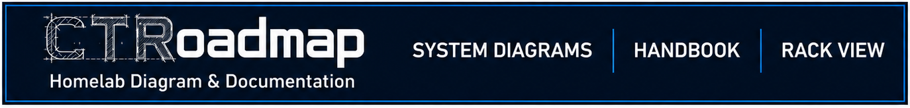

<p align="center">
  <a href="https://github.com/NoobCity99/CTRoadmap/stargazers">
    
  </a>
  <a href="https://github.com/NoobCity99/CTRoadmap/pkgs/container/ctroadmap">
    
  </a>
</p>

<p align="center">
  
  


</p>

<p align="center">
  <strong>LANGUAGE:</strong>
  <a href="README.md"></a>
  <a href="README.es.md"></a>
  <a href="README.it.md"></a>
</p>

<p align="center">
  <a href="#installazione-della-beta-con-docker"><strong>INSTALLAZIONE</strong></a>
  &nbsp;&nbsp; | &nbsp;&nbsp;
  <a href="#funzionalità"><strong>FUNZIONALITÀ</strong></a>
  &nbsp;&nbsp; | &nbsp;&nbsp;
  <a href="#sviluppo"><strong>SVILUPPO</strong></a>
</p>

CTRoadmap è uno strumento self-hosted per creare diagrammi e documentare il tuo **HOMELAB** attraverso nodi, servizi, sistemi di archiviazione, script, configurazioni, URL e relazioni operative. CTR vuole offrire qualcosa in più rispetto a PowerPoint e alle altre applicazioni per *diagrammi*. Per scelta, è un archivio autonomo, NON INTEGRATO con il sistema che descrive. Non monitora né controlla il tuo homelab. Serve solo a documentarlo. È un’applicazione web distribuita tramite Docker, accessibile dal browser, che salva la documentazione del sistema in un file atlas.json.

CTRoadmap rimane un’applicazione pensata per documentare l’infrastruttura in locale. Non è una piattaforma di monitoraggio o controllo remoto. Il **NUOVO** strumento opzionale **Snapshot del sistema** raccoglie informazioni sull’infrastruttura in sola lettura e solo quando decidi di eseguirlo sul tuo host Linux. L’applicazione web non avvia scansioni né aggiunge automaticamente all’Atlante gli elementi rilevati. Sei tu a esaminare e approvare le modifiche proposte prima che vengano salvate.


<table>
  <tr>
    <td></td>
    <td></td>
  </tr>
  <tr>
    <td></td>
    <td></td>
  </tr>
</table>

## Installazione della beta con Docker

Per un’installazione standard su Linux, **usa il programma di installazione di CTRoadmap riportato di seguito**. Configura sia l’applicazione Docker sia i componenti sull’host necessari per gli aggiornamenti e per lo snapshot del sistema.

### Installazione standard su Linux con Docker

Requisiti:

- Server Linux
- Docker
- Docker Compose v2
- `curl`
- Bash, `sha256sum`, utilità standard di Linux e certificati delle autorità di certificazione (CA)
- Porta 8088 raggiungibile se accedi a CTRoadmap da un altro computer

Installazione consigliata:

```bash
curl -fsSL https://raw.githubusercontent.com/NoobCity99/CTRoadmap/main/CTR_install.sh -o CTR_install.sh
chmod +x CTR_install.sh
./CTR_install.sh
```

Il programma di installazione scarica e verifica `ctr_update.sh`, il programma di aggiornamento attendibile per l’host, quindi gli affida l’installazione. Quest’ultimo prepara le directory dell’applicazione, installa le utilità per gli snapshot, configura Docker Compose, avvia CTRoadmap e verifica che l’applicazione funzioni correttamente. **Durante l’installazione non viene eseguita alcuna scansione della rete.**

Installazione con un solo comando:

```bash
curl -fsSL https://raw.githubusercontent.com/NoobCity99/CTRoadmap/main/CTR_install.sh | bash
```

Directory di installazione personalizzata:

```bash
CTR_INSTALL_DIR=/opt/ctroadmap-beta ./CTR_install.sh
```

Dopo l’installazione, apri:

```text
http://YOUR-SERVER-IP:8088
```

La directory di installazione predefinita è:

```text
~/ctroadmap-beta
```

**Dietro le quinte:** il programma di installazione distribuisce l’immagine Docker ufficiale della beta di CTRoadmap:

```text
ghcr.io/noobcity99/ctroadmap:beta
```

Per un’installazione standard su Linux **non** devi clonare questo repository né installare autonomamente Python, Node.js, npm o WhosThere. Il programma di installazione e quello di aggiornamento dell’host si occupano dei componenti necessari per l’applicazione e gli snapshot.

### Supporto per AMD64 e ARM64 (novità della v0.9)

A partire dalla **v0.9.0-beta**, CTRoadmap supporta i sistemi Linux sia **AMD64 (x86-64)** sia **ARM64 (ARM a 64 bit)**. È quindi compatibile anche con server domestici basati su ARM, computer a scheda singola e dispositivi NAS compatibili.

L’immagine Docker ufficiale supporta entrambe le architetture con lo stesso tag `:beta`. Docker seleziona automaticamente la versione corretta per il tuo sistema, quindi **non occorrono download, tag di immagine o procedure di installazione separati**.

Nelle installazioni standard su Linux, il programma di installazione di CTRoadmap e quello di aggiornamento dell’host predispongono anche le utilità per gli snapshot specifiche per l’architettura in uso. Chi utilizza un NAS o Portainer deve continuare a seguire le consuete procedure di distribuzione e aggiornamento della propria piattaforma.

### Installazione su Synology, NAS o Portainer

Puoi distribuire CTRoadmap anche in ambienti Docker gestiti tramite un NAS o Portainer.

Queste piattaforme hanno procedure proprie per l’installazione e la gestione dei container, quindi questo README non ripete le istruzioni di configurazione specifiche per ciascuna piattaforma. Scaricare o aggiornare l’immagine Docker tramite NAS o Portainer **non** installa né registra il programma di aggiornamento dell’host Linux di CTRoadmap o gli strumenti per gli snapshot. In questa beta lo snapshot del sistema non è disponibile con il metodo di aggiornamento Platform / NAS Managed.

Per le istruzioni di installazione su NAS o con Portainer, consulta:

**https://mariushosting.com/?s=ctroadmap**

### Comandi di gestione più comuni

Per l’installazione Linux predefinita:

```bash
cd ~/ctroadmap-beta
docker compose logs -f
docker compose down
docker compose up -d
./ctr_update.sh
```

Se hai installato CTRoadmap altrove, usa la directory di quell’installazione.

### Disinstallazione

```bash
curl -fsSL https://raw.githubusercontent.com/NoobCity99/CTRoadmap/main/CTR_uninstall.sh -o CTR_uninstall.sh
chmod +x CTR_uninstall.sh
./CTR_uninstall.sh
```

Per impostazione predefinita, il programma di disinstallazione arresta CTRoadmap e conserva l’installazione e i dati persistenti.

Per un’installazione personalizzata:

```bash
CTR_INSTALL_DIR='/absolute/install/path' bash ./CTR_uninstall.sh
```

Per confermare esplicitamente l’eliminazione completa, digita:

```text
DELETE
```

Prima di scegliere l’eliminazione completa, esegui un backup di tutto ciò che vuoi conservare.

<details>
<summary><strong>Dettagli sulla disinstallazione e sul ripristino</strong></summary>

Il programma di disinstallazione verifica l’esatta installazione di CTRoadmap prima di eliminare qualsiasi elemento. Tenta prima la normale eliminazione e usa `sudo` solo se rimangono file protetti creati dal container.

Se la configurazione di Compose è assente o danneggiata, è disponibile una procedura di ripristino purché sia ancora possibile identificare con certezza l’installazione tramite le directory locali `data` / `exports` oppure tramite il container CTRoadmap previsto e i relativi bind mount. Se l’identificazione è incerta, l’eliminazione si interrompe.

L’eliminazione completa rimuove soltanto l’installazione di CTRoadmap identificata e il riferimento esatto all’immagine CTRoadmap inutilizzata, se identificabile con certezza. Gli altri tag delle immagini, i file ausiliari estranei all’installazione, le reti e i log dei test vengono conservati.

</details>

L’installazione predefinita usa le seguenti directory per i dati dell’applicazione, le esportazioni generate e lo scambio degli snapshot:

```text
~/ctroadmap-beta/data
~/ctroadmap-beta/exports
~/ctroadmap-beta/imports
```

Il programma di aggiornamento predispone anche `~/ctroadmap-beta/tools/` per le utilità che gestiscono gli snapshot sull’host.

## Eseguire CTRoadmap con Docker

Usa i seguenti comandi Docker Compose per gestire un’istanza di CTRoadmap **già installata**. Per una nuova installazione completa su Linux, usa il programma di installazione indicato sopra. Scaricare soltanto l’immagine o eseguire `docker compose up` non registra il programma di aggiornamento dell’host né predispone gli strumenti per gli snapshot. Il file `docker-compose.yml` del repository del codice sorgente è destinato alle build di sviluppo.

```bash
docker compose up -d
```

Apri:

```text
http://localhost:8088
```

Arresta:

```bash
docker compose down
```

Visualizza i log:

```bash
docker compose logs -f
```

L’**applicazione web** di CTRoadmap si limita a segnalare gli aggiornamenti e a indicare se gli strumenti per gli snapshot sono pronti. Non esegue mai comandi della shell dell’host, comandi Docker, il programma di aggiornamento dell’host o una scansione per generare uno snapshot. Non monta il socket Docker. Sei tu a eseguire i comandi sull’host dal tuo terminale.

## Aggiornare CTRoadmap

Nelle installazioni standard su Linux, il **programma di aggiornamento dell’host** (`ctr_update.sh`) gestisce gli aggiornamenti dell’applicazione e mantiene l’integrazione con l’host utilizzata per gli snapshot del sistema. Dalla versione v0.2.0 può anche aggiornare in modo sicuro il proprio eseguibile durante un normale aggiornamento.

CTRoadmap ti avvisa quando è disponibile un aggiornamento, ma **sei tu a decidere quando eseguire qualsiasi operazione sull’host**. L’applicazione web non esegue mai l’aggiornamento al posto tuo.

Premi il pulsante animato di aggiornamento nella barra superiore oppure vai a:

**Impostazioni → Updates & App Data → Updates**

La schermata di aggiornamento mostra la versione in esecuzione, l’ultima versione disponibile, il metodo di aggiornamento, lo stato del programma di aggiornamento, le note di rilascio e l’esito dell’ultimo aggiornamento sull’host.

Per seguire il nuovo processo di aggiornamento passo dopo passo:

**https://youtu.be/J1XttoXelqs**

### Installazioni standard su Linux

Per una normale installazione Linux, la procedura di aggiornamento supportata è:

```bash
cd ~/ctroadmap-beta
./ctr_update.sh
```

Se hai scelto una directory di installazione personalizzata, esegui il programma di aggiornamento da quella directory.

Quando è disponibile un aggiornamento, CTRoadmap può offrire l’azione **BACKUP ATLAS + COPY UPDATE COMMAND**. L’applicazione salva prima l’Atlante corrente e avvia il download di una copia JSON con data e ora, quindi copia il comando da eseguire sull’host.

`ctr_update.sh` gestisce l’aggiornamento sull’host:

- Verifica l’installazione, la configurazione di Docker e Compose e la compatibilità dell’architettura dell’host.
- Controlla se è disponibile una versione compatibile e verificata del programma di aggiornamento e può aggiornarsi prima di procedere con l’aggiornamento ordinario.
- Impedisce l’esecuzione contemporanea di più istanze del programma di aggiornamento.
- Prepara e verifica il mount in sola lettura `imports/`, preservando i mount personalizzati supportati per i dati e le esportazioni.
- Installa o ripara in `tools/` le utilità verificate per gli snapshot del sistema, comprese WhosThere e le utilità di inventario locale e normalizzazione.
- Scarica l’immagine della versione corrente di CTRoadmap, ricrea il container quando necessario e verifica `/api/health`.
- Registra lo stato del programma di aggiornamento e dell’integrazione, così l’applicazione può segnalare se sono pronti e mostrare gli esiti precedenti.

Il consueto comando di aggiornamento può ripristinare l’integrazione degli snapshot se manca, anche quando l’immagine dell’applicazione è già aggiornata. Il programma di aggiornamento **non** modifica l’Atlante né elimina risorse Docker inutilizzate. Non installa pacchetti di sistema, non usa `sudo` senza avvisare e non sposta l’installazione.

L’aggiornamento del container dell’applicazione non prevede il ripristino automatico della versione precedente. Se l’aggiornamento fallisce, il programma conserva i dati persistenti dell’Atlante e le esportazioni e fornisce informazioni diagnostiche prima che tu riprovi. Verifica i backup importanti prima di aggiornare.

### Per chi usa già CTRoadmap: migrazione una tantum al nuovo programma di aggiornamento

Un’installazione Linux standard che usa ancora il **programma di aggiornamento dell’host v0.1.1** richiede una configurazione o un ripristino una tantum per passare al programma di aggiornamento **v0.2.0**, compatibile con la v0.9. La versione precedente non può aggiornarsi da sola. Al posto della consueta azione di aggiornamento, CTRoadmap può mostrare uno di questi stati:

- **FINISH UPDATE SETUP** (completare la configurazione degli aggiornamenti)
- **REPAIR REQUIRED** (è necessaria una riparazione)
- **UPDATER REFRESH REQUIRED** (occorre rinnovare il programma di aggiornamento)
- **LEGACY UPDATE METHOD DETECTED** (è stato rilevato un metodo di aggiornamento precedente)

**Non devi reinstallare CTRoadmap.** Segui le indicazioni nella schermata di aggiornamento per eseguire il comando verificato di configurazione, riparazione o ripristino. Il comando usa `--register-only` per installare e registrare il programma di aggiornamento compatibile. In questa fase **non** scarica una nuova immagine dell’applicazione né la riavvia. Anche la configurazione di Compose resta invariata e gli strumenti per gli snapshot non vengono ancora installati.

Dopo questa configurazione iniziale:

1. Torna a **Impostazioni → Updates & App Data → Updates** e scegli **Check Now** per cercare aggiornamenti.
2. Esegui il normale comando di aggiornamento dell’host mostrato da CTRoadmap (oppure esegui `./ctr_update.sh` dalla directory di installazione).
3. Lascia che il programma completi l’aggiornamento dell’applicazione e verifichi o installi l’integrazione di `imports/` e gli strumenti per gli snapshot. Il normale comando di aggiornamento gestirà anche le future patch supportate per il programma di aggiornamento.

Questa procedura consente il ripristino anche a chi ha saltato una versione di transizione o ha aggiornato soltanto il container Docker. **Aggiornare la sola immagine Docker non aggiorna il programma di aggiornamento dell’host né abilita gli snapshot del sistema.** La funzione snapshot rimane disattivata finché l’applicazione non può verificare che l’integrazione con l’host sia completa.

### Installazioni gestite tramite NAS o Portainer

**Non** passare al programma di aggiornamento dell’host Linux se lo stack CTRoadmap è gestito tramite un NAS o Portainer.

Scegli **Platform / NAS Managed** nelle impostazioni di aggiornamento di CTRoadmap e continua a usare la normale procedura di aggiornamento per la tua installazione NAS o Portainer.

Per le indicazioni specifiche per la tua piattaforma, consulta:

**https://mariushosting.com/?s=ctroadmap**

Quando l’installazione è configurata come Platform / NAS Managed, la finestra di aggiornamento di CTRoadmap non propone il comando per aggiornare l’host Linux. Con questo metodo è disabilitato anche il menu degli snapshot del sistema della v0.9. Il solo aggiornamento del container sul NAS non predispone gli strumenti e il mount necessari sull’host.

### Verifica degli aggiornamenti e promemoria

**Check Now** verifica in quel momento se ci sono aggiornamenti senza abilitare in modo permanente i controlli in background.

Se CTRoadmap non riesce a raggiungere il manifesto degli aggiornamenti, può continuare a mostrare le informazioni sulle versioni precedenti, ma non considera sicuro eseguire un comando obsoleto. I comandi di aggiornamento tornano disponibili solo dopo che una nuova verifica online è andata a buon fine.

**Remind Me Later** rinvia di 24 ore l’avviso di aggiornamento nel browser in uso.

Se il programma di aggiornamento dell’host segnala un aggiornamento non riuscito, lo stato **UPDATE FAILED** ha la precedenza, così puoi verificare l’errore prima di riprovare.

### Backup dell’Atlante prima dell’aggiornamento

La finestra di aggiornamento consente di scaricare un backup JSON dell’Atlante con data e ora prima di eseguire un comando di aggiornamento.

Il backup JSON dell’Atlante comprende la struttura e la documentazione dell’Atlante corrente. **Non** include tutti i file persistenti utilizzati da CTRoadmap.

Per il backup dell’intera installazione, consulta la sezione seguente.

## Dati e backup

CTRoadmap salva lo stato persistente al di fuori del container sostituibile dell’applicazione. In questo modo, sostituire o aggiornare il container non sovrascrive l’Atlante.

### Backup rapido dell’Atlante

Usa **Scarica l’atlante** o **BACKUP ATLAS** nella schermata di aggiornamento per salvare una copia JSON portabile dell’Atlante corrente.

### Backup completo di CTRoadmap

Per poter ripristinare l’Atlante, le risorse caricate, le impostazioni e i file generati, conserva **`data/` ed `exports/`**. Per un backup più completo dell’installazione, conserva anche gli eventuali file di snapshot importanti in `imports/`, la configurazione di Compose e il file `.env` personalizzato, se lo usi. Il programma di aggiornamento dell’host può di norma reinstallare le utilità presenti in `tools/`.

Esegui questi comandi dalla directory di installazione predefinita per creare un backup con data e ora **all’esterno** della cartella di installazione di CTRoadmap:

```bash
cd ~/ctroadmap-beta
backup_dir="$HOME/ctroadmap-backups/$(date +%Y%m%d-%H%M%S)"
mkdir -p "$backup_dir"
cp -a data exports docker-compose.yml "$backup_dir/"
[ ! -d imports ] || cp -a imports "$backup_dir/"
[ ! -f .env ] || cp -a .env "$backup_dir/"
```

Per un’installazione personalizzata, adatta il comando `cd` iniziale. Proteggi i backup che contengono la configurazione del codice di accesso locale o altre impostazioni private. Conserva i backup importanti fuori dalla directory di installazione di CTRoadmap prima di disinstallarlo o di apportare modifiche distruttive all’host.

I dati persistenti comprendono:

- `data/atlas.json` — l’Atlante di riferimento, che contiene schede, relazioni, famiglie, pile, rack, flussi, impostazioni del manuale e livelli salvati.
- `data/history/` — cronologia persistente a rotazione delle operazioni Annulla e Ripeti.
- `data/assets/icons/` — icone caricate tramite la raccolta di icone.
- `data/assets/handbook/` — file di immagine del logo del manuale.
- `data/auth.json` — configurazione del codice di accesso locale e stato delle sessioni quando la protezione è abilitata.
- `data/update_state.json` — impostazioni degli aggiornamenti e stato degli avvisi memorizzato nella cache.
- `data/host_updater_state.json` — registrazione del programma di aggiornamento dell’host, ultimo esito e stato dell’integrazione degli snapshot.
- `exports/` — file generati in Markdown, YAML, Mermaid e altri formati di esportazione.
- `imports/ctr-system-snapshot.json` — l’ultimo snapshot del sistema, se hai eseguito il comando sull’host. Puoi conservarlo per consultarlo in seguito.
- `tools/` — utilità verificate per gli snapshot che il programma di aggiornamento fornisce sull’host e che di norma può reinstallare.

Il file JSON dell’Atlante è pensato per essere portabile. Non è un archivio completo delle immagini caricate, delle impostazioni di autenticazione, della cronologia, dello stato degli aggiornamenti, dei file di snapshot o delle esportazioni già generate.

La barra degli strumenti permette di annullare e ripetere le modifiche all’Atlante di riferimento, conservandone la cronologia. La cronologia si mantiene anche dopo il riavvio del browser o del container, mentre `data/atlas.json` rimane un normale Atlante autonomo che puoi copiare o importare separatamente.

# FUNZIONALITÀ

## Codice di accesso locale

Il codice di accesso locale offre un meccanismo di autenticazione facoltativo per l’interfaccia web di CTRoadmap. La protezione è disabilitata finché non imposti un codice nelle impostazioni.

Da **Impostazioni → Passcode** puoi:

- Creare o cambiare il codice di accesso.
- Chiudere la sessione del browser corrente.
- Chiudere tutte le sessioni attive.
- Rimuovere la protezione tramite codice di accesso.

Questo controllo degli accessi opera a livello di applicazione ed è pensato per un’installazione locale. Continua ad adottare misure di sicurezza adeguate sulla rete e sull’host per le installazioni esposte al di fuori di una LAN o VPN fidata.

## Funzionalità

### Editor del Canvas

Il Canvas è l’area di lavoro visiva principale in cui documentare come si collegano i componenti del tuo homelab.

- Crea, modifica, duplica, elimina, trascina, cerca e filtra le schede dell’infrastruttura.
- Rappresenta nodi, servizi, container, unità, punti di mount, script, configurazioni, riferimenti a segreti, flussi, dispositivi IoT, URL, verifiche e note.
- Designa i nodi principali e disponi le schede figlie sotto i sistemi a cui appartengono.
- Crea relazioni di diversi tipi e modificane etichette, note, estremi, porte e direzione.
- Trascina un collegamento tra due schede per aprire **Crea relazione**. Scegli il rapporto strutturale fra le schede (per esempio, gerarchia padre/figlio o nessun legame gerarchico) e il tipo di connettore. Sono disponibili solo le opzioni strutturali ammesse, per evitare modifiche non valide alla gerarchia o alle famiglie.
- Scegli se i connettori possono attraversare le schede o se devono aggirarle.
- Blocca il Canvas per evitare modifiche accidentali durante la navigazione.
- Documenta le verifiche nei campi dedicati al comando e al risultato atteso, senza eseguire i comandi.
- Usa il salvataggio automatico per le modifiche ordinarie all’Atlante o il comando manuale Salva quando vuoi salvare subito.

### Schede di flusso e diagrammi a corsie

Le schede di flusso permettono di documentare processi e flussi di lavoro operativi accanto ai sistemi dell’Atlante.

- Aggiungi un flusso dalla tavolozza delle schede, selezionalo e scegli **Apri l’area di lavoro Flusso**.
- Crea processi usando corsie modificabili ed elementi di processo, decisione, attesa, azione utente, inizio, fine e nota.
- Trascina gli elementi tra le corsie e collegali per rappresentare visivamente il flusso di lavoro.
- Collega le corsie alle schede o alle famiglie dell’Atlante affinché il flusso possa fare riferimento ai sistemi coinvolti.
- Modifica la documentazione del flusso, le corsie, gli elementi, i connettori e i riferimenti all’Atlante dall’area di lavoro del flusso.
- Consulta il diagramma a corsie in sola lettura all’interno del manuale.
- Esporta in PNG il diagramma a corsie completo di un flusso.
- Apri in sola lettura i flussi bloccati in base allo stato del loro ciclo di vita.

Le schede di flusso preesistenti basate su passaggi sono ancora supportate e modificabili. Le nuove schede di flusso usano l’area di lavoro a corsie.

I flussi e le verifiche hanno unicamente valore documentale. CTRoadmap non esegue le procedure che documenti.

### Manuale

Il manuale trasforma l’Atlante in una raccolta strutturata e consultabile di documentazione tecnica, note di configurazione, riferimenti di rete e schede dell’infrastruttura fisica.

- **Documentazione organizzata dell’infrastruttura:** Esplora i sistemi per nodo principale, famiglia, gerarchia e relazione. Passa dalle voci del manuale alle corrispondenti schede del Canvas e viceversa. La documentazione dei flussi e i diagrammi a corsie si possono consultare accanto ai sistemi coinvolti.

- **NotePages e documentazione tecnica:** Per ogni scheda puoi mantenere più pagine con un nome, usando testo semplice, Markdown o contenuti di configurazione e codice. Organizza le pagine in schede riordinabili e continua a modificare la documentazione generata dagli snapshot anche dopo l’importazione.

- **Editor integrato di codice e configurazioni:** Scrivi e mantieni script, file di configurazione e altri contenuti tecnici nel manuale o nell’editor di codice a pagina intera. L’editor offre evidenziazione della sintassi per 30 linguaggi, gestione delle bozze, confronto del codice e controlli delle configurazioni. Quando passi da una bozza all’altra conserva la posizione di modifica e la cronologia locale.

- **Documentazione collegata con HyperNotes:** Usa i riferimenti `@@` nelle note Markdown per spostarti tra le schede dell’Atlante o inserire nelle note e nel codice i valori correnti dei campi delle schede. I riferimenti alle schede consentono di navigare nel manuale e nelle esportazioni PDF compatibili.

- **Riferimenti di rete e rubrica:** Raccogli indirizzi IP, domini e URL dalla documentazione di tutto l’Atlante. Puoi aprire gli indirizzi riconosciuti direttamente dai campi supportati e seguire i collegamenti per tornare alla documentazione originale.

- **Documentazione dell’infrastruttura fisica:** Consulta le apparecchiature dei rack, le porte fisiche, i collegamenti dei pannelli di permutazione, gli elenchi dei cavi, gli alloggiamenti per le unità e l’archiviazione dei server accanto ai sistemi logici documentati nell’Atlante.

- **Esportazioni flessibili:** Esporta singole NotePages e bozze di codice come PDF, testo semplice, Markdown o file nel formato di codice o configurazione appropriato. Genera PDF completi del manuale con copertina, navigazione, indice gerarchico, segnalibri, volumi e sezioni configurabili, tra cui la rubrica, i diagrammi a corsie, il cablaggio fisico e la documentazione opzionale degli snapshot.

- **Personalizzazione e accesso:** Aggiungi al manuale un logo personalizzato e consulta la documentazione dalla vista mobile in sola lettura.

Il manuale lavora direttamente con l’Atlante senza mantenere una copia separata della documentazione dell’infrastruttura.

### Editor della vista rack

L’editor della vista rack offre una rappresentazione fisica dell’infrastruttura che riunisce posizione delle apparecchiature, connettività, configurazione dell’archiviazione e aspetto personalizzabile dei rack.

- **Disposizione e organizzazione delle apparecchiature:** Crea rack e colloca le apparecchiature in posizioni specifiche misurate in unità rack. Usa le viste Front, Rear o Both per vedere la parte anteriore, quella posteriore o entrambe. Puoi collegare le apparecchiature a schede già presenti nell’Atlante o crearle come componenti locali del rack senza alterare la gerarchia del Canvas.

- **Posizionamento flessibile delle apparecchiature:** Configura le larghezze e le profondità supportate, verifica l’ingombro in anteprima durante il trascinamento e usa il posizionamento adattivo in base allo spazio disponibile. Le apparecchiature idonee possono anche essere montate sopra i rack compatibili.

- **Porte fisiche e collegamenti via cavo:** Definisci le porte delle apparecchiature, collega dispositivi compatibili e documenta le connessioni DATA, VIDEO e POWER, comprese quelle PoE. Segui il cablaggio fisico attraverso pannelli di permutazione e backplane, tra i lati del rack e lungo percorsi composti da più cavi. La documentazione del cavo si conserva anche quando una delle estremità è temporaneamente scollegata.

- **Tracciamento e identificazione dei collegamenti:** Usa la tabella delle connessioni per esaminare i collegamenti documentati e identificare i circuiti associati. Selezionando apparecchiature o porte puoi evidenziare le connessioni e i percorsi dei cavi correlati.

- **Alloggiamenti per le unità e archiviazione dei server:** Rappresenta gli alloggiamenti dei tipi Direct e Backplane e gli slot numerati per le unità dei server. Le configurazioni di archiviazione rimangono associate alle apparecchiature e possono essere documentate nel manuale.

- **Apparecchiature e pannelli frontali personalizzati:** Usa pannelli frontali schematici o basati su immagini, crea pannelli ciechi in ABS e personalizza elementi decorativi come ventole e griglie.

- **Aspetto e accessori del rack:** Personalizza colori, sfondi, finiture dei materiali, maniglie, ruote, aspetto delle apparecchiature e grafiche per creare una rappresentazione fisica riconoscibile della tua installazione.

- **Documentazione ed esportazioni:** Esamina la disposizione dei rack da desktop o da mobile, genera immagini dei rack e consulta dal manuale e dai PDF esportati compatibili le informazioni su apparecchiature, cablaggio e archiviazione.

La documentazione fisica dei rack completa le relazioni logiche del Canvas senza richiedere modifiche alla gerarchia dei sistemi.

### Livelli

I livelli permettono di salvare viste mirate di singole parti di un Atlante più ampio.

- Crea, rinomina, modifica ed elimina i livelli salvati.
- Filtra per tipo di scheda, stato del ciclo di vita, famiglia e visibilità delle relazioni.
- Usa i livelli per concentrarti su parti diverse dello stesso Atlante senza duplicare o eliminare elementi dell’infrastruttura.
- Cambia la disposizione dove questa opzione è supportata, mantenendo intatto l’Atlante sottostante.

### Modalità di pianificazione

La modalità di pianificazione permette di documentare le modifiche all’infrastruttura prima di realizzarle.

- Crea schede e relazioni pianificate separatamente dall’infrastruttura in uso.
- Distingui visivamente i sistemi pianificati da quelli in uso.
- Sviluppa le modifiche future senza presentarle come già operative.
- Porta gli elementi pianificati allo stato «in uso» quando il lavoro è completato.

### Famiglie

Le famiglie raggruppano visivamente le parti correlate di un sistema più ampio.

- Raggruppa le schede esistenti in famiglie contraddistinte da un nome e da un colore.
- Usa le aree delle famiglie sul Canvas per organizzare i sistemi più estesi.
- Sfrutta l’organizzazione per famiglie in tutto il manuale e nei filtri dei livelli.
- Sposta o ridimensiona la rappresentazione visiva di una famiglia senza modificare le relazioni dell’infrastruttura tra i suoi membri.

### Pile

Le pile riducono l’affollamento visivo quando un nodo contiene molti elementi figli correlati.

- Comprimi in pile compatte le schede correlate che hanno lo stesso padre.
- Impila le schede figlie collegate da una relazione di mount supportata.
- Espandi gli elementi, portali in primo piano o separali dalla pila senza eliminare o modificare i corrispondenti oggetti dell’Atlante.
- Mantieni leggibili anche i sistemi più densi, conservando le loro relazioni effettive.

### Snapshot del sistema e INGEST

Lo **snapshot del sistema** offre un modo facoltativo per rilevare e documentare l’infrastruttura esistente su tua iniziativa. Gli strumenti sull’host abbinano una singola scansione di rilevamento della LAN con **WhosThere** all’**inventario Linux locale** di CTRoadmap (per esempio servizi, container, reti, archiviazione e mount), quindi verificano i risultati e li riuniscono in un unico snapshot. Il processo è in sola lettura e non altera i servizi dell’host né modifica l’Atlante.

1. **Raccogli i dati:** In **Importa → Snapshot del sistema**, seleziona **COPY COMMAND** ed esegui il comando sull’host Linux da un terminale o da una sessione SSH. L’applicazione web non lo avvia.
2. **Prepara lo snapshot:** Gli strumenti sull’host generano `imports/ctr-system-snapshot.json`. CTRoadmap lo legge tramite un mount Docker in sola lettura. La finestra dello snapshot attende un file valido più recente e, quando questo è disponibile, propone **REVIEW SNAPSHOT**. Puoi anche esaminare lo snapshot esistente in un secondo momento.
3. **Esamina i dati in INGEST:** Controlla gli elementi rilevati, seleziona quelli da includere, modifica i tipi e la gerarchia proposti e risolvi le possibili corrispondenze con le schede esistenti. Puoi anche esaminare le informazioni nel pannello INGEST prima di approvarle.
4. **Importa:** Scegli **IMPORT SELECTIONS** per aggiungere gli elementi approvati all’Atlante corrente oppure seleziona esplicitamente **Replace the current Atlas with this ingest** se desideri sostituirlo. La sola scansione non aggiunge nulla. L’importazione è una modifica dell’Atlante che decidi tu e che puoi esaminare prima di applicarla.

Per lo scambio dei dati viene usato un nome di file fisso: **`ctr-system-snapshot.json`**. Gli strumenti per gli snapshot non selezionano automaticamente copie come `ctr-system-snapshot (1).json`, non mantengono una cronologia delle scansioni e non monitorano continuamente la rete. Uno snapshot appena generato sostituisce il file precedente solo se è più recente. Se vuoi mantenere un archivio, conserva altrove delle copie rinominate. Dopo l’importazione puoi consultare e modificare la documentazione generata nelle NotePages del manuale.

**Disponibilità:** Nelle installazioni standard su Linux, il programma di aggiornamento dell’host predispone gli strumenti per gli snapshot e il mount delle importazioni in sola lettura. Se la configurazione non è stata verificata (per esempio dopo aver aggiornato manualmente solo l’immagine Docker), **Importa → Snapshot del sistema** rimane disabilitato e rimanda alle istruzioni per l’aggiornamento. Questa beta v0.9 non abilita gli snapshot con il metodo Platform / NAS Managed.

### Importazione ed esportazione

CTRoadmap offre vari modi per eseguire il backup della documentazione, trasferirla, pubblicarla o condividerla.

**Backup e ripristino dell’Atlante**

- Scarica l’Atlante corrente come file JSON portabile.
- Importa un file JSON dell’Atlante con convalida e anteprima prima di sostituire l’Atlante corrente.

**Snapshot del sistema / INGEST**

- Avvia la scansione facoltativa sull’host, esamina gli elementi raccolti e poi aggiungi l’infrastruttura selezionata o sostituisci l’Atlante. Vedi la sezione [Snapshot del sistema e INGEST](#snapshot-del-sistema-e-ingest) più sopra.

**Importazione assistita da LLM**

- Seleziona **Importa → Importazione assistita da LLM** per scaricare la **guida di CTRoadmap all’importazione con LLM**.
- Fornisci la guida e il tuo inventario o la documentazione esistente a un modello linguistico (LLM) esterno di tua scelta. Chiedigli di preparare un file `atlas.json` pronto per l’importazione, quindi torna a **Importa → Importa atlante JSON** per convalidare e importare il risultato.
- CTRoadmap non esegue né contatta un LLM per conto tuo. Mentre la procedura predefinita degli snapshot aggiunge elementi, **l’importazione di un Atlante in formato JSON sostituisce l’Atlante corrente** dopo la conferma.

**Esportazioni della documentazione**

- Genera esportazioni in Markdown, YAML e Mermaid.
- Esporta l’intero manuale come PDF impaginato, con opzioni per la rubrica, i diagrammi a corsie, la documentazione degli snapshot e l’indice.

**Esportazioni di immagini**

- Esporta in PNG l’intero livello attivo del Canvas con il suo stile grafico.
- Prima di scaricare il PNG del Canvas, configura il titolo e le opzioni del cartiglio.
- Esporta in PNG il diagramma a corsie completo di un flusso dalla relativa voce del manuale.

Il file JSON contiene l’Atlante stesso. Le immagini caricate, le impostazioni di autenticazione, la cronologia persistente, lo stato degli aggiornamenti e le esportazioni già generate sono conservati separatamente. Per preservare l’intera installazione occorre un backup completo dei dati persistenti.

### Vista mobile

CTRoadmap include un’interfaccia mobile in sola lettura, adatta agli schermi tattili, per consultare la documentazione da telefono o tablet.

Dalla vista mobile puoi consultare:

- Il Canvas
- Il manuale
- La vista rack
- I diagrammi di flusso a corsie

La vista mobile è pensata per consultare le informazioni. L’accesso in sola lettura aiuta a evitare modifiche accidentali quando controlli l’infrastruttura lontano dall’editor desktop.

### Aspetto

CTRoadmap offre due modalità per l’aspetto dell’applicazione: **CLASSIC** e **ZIMA**.

- Usa **Impostazioni → Appearance / Themes** per cambiare l’aspetto dell’applicazione.
- Scegli temi e sfondi del Canvas e visualizzali in anteprima prima di applicarli.
- Assegna alle schede icone integrate o caricate da te, tramite la raccolta di icone.
- Modifica l’aspetto del Canvas e dei connettori senza modificare l’Atlante sottostante.

### Impostazioni e amministrazione

Le impostazioni si aprono in una finestra di dialogo centrale con i controlli principali raggruppati per sezione:

- **APPEARANCE / THEMES** — aspetto dell’applicazione, temi del Canvas, sfondi e opzioni grafiche.
- **UPDATES & APP DATA** — stato degli aggiornamenti, disponibilità del programma di aggiornamento dell’host, ricerca di aggiornamenti, metadati dell’applicazione e controlli correlati.
- **PREFERENCES** — preferenze di interfaccia e interazione.
- **DEBUG LOG** — consulta o esporta informazioni utili alla risoluzione dei problemi.
- **PASSCODE** — configura il codice di accesso locale e i controlli delle sessioni.

Le impostazioni offrono anche collegamenti rapidi ai tutorial e alle risorse della comunità di CTRoadmap.

I passaggi dei flussi, i comandi di verifica e i risultati attesi hanno scopo esclusivamente documentale. CTRoadmap non li esegue.

## Sviluppo

### Modello a codice sorgente suddiviso

Per CTRoadmap ho scelto un **modello di sviluppo a codice sorgente suddiviso e nucleo aperto (open core)**. Il codice disponibile pubblicamente riguarda soprattutto il Canvas e le funzioni di creazione dei diagrammi. L’applicazione completa, che comprende il manuale, la vista rack e la vista mobile, viene sviluppata in un repository privato e distribuita tramite l’immagine Docker pubblica.

Attualmente il repository pubblico non contiene tutto il codice sorgente dell’applicazione distribuita e il codice relativo ai diagrammi può essere meno aggiornato rispetto all’ultima versione rilasciata. Il mio obiettivo è allineare progressivamente l’implementazione pubblica del Canvas alla versione distribuita, mantenendo flessibilità nello sviluppo di funzionalità aggiuntive.

**Per chi desidera contribuire:** Poiché il codice pubblico e quello privato differiscono, apri una segnalazione o una discussione prima di intraprendere un lavoro di sviluppo sostanziale che intendi integrare nel progetto principale.

### Metodo di sviluppo — RailCoding

Sviluppo CTRoadmap con un notevole contributo dell’agente di programmazione CODEX, seguendo una metodologia strutturata che chiamo **RailCoding**. Svolgo tutta la pianificazione e la progettazione in un progetto ChatGPT. Una volta definite le specifiche di implementazione, fornisco le istruzioni a CODEX e poi eseguo test approfonditi.

Invece di delegare intere funzionalità a un agente senza dargli indicazioni, affronto lo sviluppo come una serie di attività di ingegneria ben definite e verificabili. Il mio ruolo consiste nello stabilire i requisiti del prodotto, prendere le decisioni progettuali e architetturali, definire i vincoli e convalidare l’implementazione risultante.

In genere il processo segue questi passaggi:

1. **Pianificare e specificare** — Definire per iscritto nelle specifiche di implementazione il comportamento, l’ambito, i vincoli e i criteri di accettazione della funzionalità.
2. **Stabilire i vincoli** — Usare la documentazione del progetto, i riferimenti architetturali e le istruzioni di `AGENTS.md` per guidare l’implementazione e proteggere le funzionalità esistenti.
3. **Implementare per gradi** — Suddividere il lavoro in fasi mirate ed esaminare le modifiche al codice e le implicazioni architetturali, evitando revisioni estese e incontrollate.
4. **Convalidare e collaudare** — Verificare gli schemi dei dati, le interfacce e la compatibilità. Eseguire i test automatici pertinenti, le build e le prove funzionali manuali.
5. **Riesaminare e perfezionare** — Indagare sui malfunzionamenti, correggere le regressioni, verificare il comportamento e documentare le modifiche completate prima di proseguire.

CODEX scrive il 99% del codice, ma **le decisioni progettuali, la direzione dello sviluppo, le priorità dei test e l’approvazione dei rilasci restano affidate alle persone**.

Questo approccio non elimina i bug né sostituisce le pratiche tradizionali di ingegneria del software, ma aumenta la probabilità di individuare gli errori prima di un rilascio. Offre un metodo ripetibile per lo sviluppo assistito dall’IA e permette di mantenere la responsabilità tecnica anche con l’evolversi del progetto.

## Scorciatoie da tastiera

| Scorciatoia          | Azione                                       |
| -------------------- | -------------------------------------------- |
| `Ctrl/Cmd + S`       | Salva immediatamente                         |
| `Ctrl/Cmd + D`       | Duplica la scheda selezionata                |
| `Delete / Backspace` | Elimina la scheda o la relazione selezionata |
| `/`                  | Porta il cursore nel campo di ricerca        |
| `Escape`             | Annulla la selezione                         |

## API

<details>
<summary><strong>Riferimento avanzato per le API</strong></summary>

```text
GET  /api/health
GET  /api/app/version
GET  /api/app/update
GET  /api/app/update?force=true
PUT  /api/app/update/settings

GET  /api/auth/status
POST /api/auth/setup
POST /api/auth/login
POST /api/auth/logout
POST /api/auth/change-passcode
POST /api/auth/remove-passcode
POST /api/auth/logout-all

GET  /api/atlas
PUT  /api/atlas
POST /api/atlas/preview
GET  /api/atlas/history
POST /api/atlas/history/undo
POST /api/atlas/history/redo

GET  /api/system-snapshot/status
POST /api/system-snapshot/review

POST   /api/assets/icons
GET    /api/assets/icons
GET    /api/assets/icons/{filename}
DELETE /api/assets/icons/{filename}
POST   /api/assets/handbook/logo
GET    /api/assets/handbook/logo/{filename}

POST /api/export/{format}
GET  /api/export/{format}/download
POST /api/export/handbook/pdf
GET  /api/export/handbook/pdf/download

GET  /api/debug/log
POST /api/debug/log/clear
```

Il server supporta i formati di esportazione `markdown`, `yaml` e `mermaid`. Il PDF del manuale usa endpoint dedicati. Le esportazioni PNG del Canvas e dei flussi vengono generate nel browser e non usano l’endpoint di esportazione del server. Gli endpoint degli snapshot leggono i dati raccolti in locale o ne consentono l’esame e **non** avviano scansioni sull’host.

</details>


## Licenza

CTRoadmap è distribuito con licenza Apache License 2.0. Consulta il file [LICENSE](LICENSE).

## Collaboratori
- NoobCity99
- OpenAi CODEX
