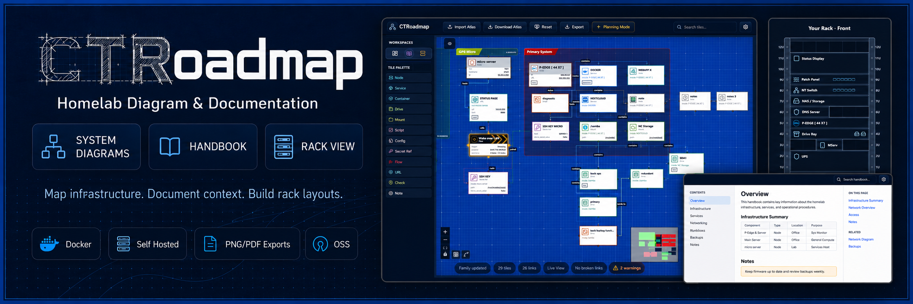

<p align="center">
  <a href="https://github.com/NoobCity99/CTRoadmap/stargazers">
    
  </a>
  <a href="https://github.com/NoobCity99/CTRoadmap/pkgs/container/ctroadmap">
    
  </a>
</p>

<p align="center">
  
  


</p>

<p align="center">
  <a href="#beta-docker-install"><strong>INSTALL</strong></a>
  &nbsp;&nbsp; | &nbsp;&nbsp;
  <a href="#features"><strong>FEATURES</strong></a>
  &nbsp;&nbsp; | &nbsp;&nbsp;
  <a href="#development"><strong>DEVELOPMENT</strong></a>
</p>

CTRoadmap is a self-hosted Diagram & Documentation tool for your **HOMELAB** via nodes, services, storage, scripts, configs, URLs, and operational relationships. Meant to be a step up from PowerPoint or other *diagram* apps, CTR intentionally a NON-INTEGRATED, stand-alone repository of your system. It does not montior or control your homelab. Just Document.  It is a Docker-served browser webapp that saves your system documentation to an atlas.json file.

CTRoadmap remains a local-first documentation application, not a monitoring or remote-control platform. Its **NEW** optional **System Snapshot** tool collects read-only infrastructure information only when you choose to run it on your Linux host. The web app does not initiate scans or automatically add discoveries to your Atlas; you review and approve proposed changes before they are saved.


<table>
  <tr>
    <td></td>
    <td></td>
  </tr>
  <tr>
    <td></td>
    <td></td>
  </tr>
</table>

## Beta Docker Install

For standard Linux installations, **use the CTRoadmap installer below**. It sets up both the Docker application and the host-side components needed for updates and System Snapshot.

### Standard Linux / Docker install

Requirements:

- Linux server
- Docker
- Docker Compose v2
- `curl`
- Bash, `sha256sum`, standard Linux utilities, and CA certificates
- Port 8088 reachable if accessing CTRoadmap from another machine

Recommended install:

```bash
curl -fsSL https://raw.githubusercontent.com/NoobCity99/CTRoadmap/main/CTR_install.sh -o CTR_install.sh
chmod +x CTR_install.sh
./CTR_install.sh
```

The installer downloads and verifies the trusted host-side `ctr_update.sh` updater, then lets it handle the installation. The updater prepares the application directories, installs the Snapshot utilities, configures Docker Compose, starts CTRoadmap, and checks that the app is healthy. **No network scan is performed during installation.**

One-liner install:

```bash
curl -fsSL https://raw.githubusercontent.com/NoobCity99/CTRoadmap/main/CTR_install.sh | bash
```

Custom install directory:

```bash
CTR_INSTALL_DIR=/opt/ctroadmap-beta ./CTR_install.sh
```

After installation, open:

```text
http://YOUR-SERVER-IP:8088
```

The default installation directory is:

```text
~/ctroadmap-beta
```

**Behind the scenes:** The installer deploys the official CTRoadmap beta Docker image:

```text
ghcr.io/noobcity99/ctroadmap:beta
```

You do **not** need to clone this repository or install Python, Node.js, npm, or WhosThere yourself for a standard Linux installation. The installer and host updater handle the required application and Snapshot components.

### AMD64 & ARM64 Support (New in v0.9)

Starting with **v0.9.0-beta**, CTRoadmap supports both **AMD64 (x86-64)** and **ARM64 (64-bit ARM)** Linux systems, expanding compatibility to ARM-based home servers, single-board computers, and compatible NAS devices.

The official Docker image supports both architectures under the same `:beta` tag. Docker automatically selects the correct version for your system, so **no separate download, image tag, or installation procedure is required**.

For standard Linux installations, the CTRoadmap installer and Host Updater also provision the appropriate architecture-specific Snapshot utilities. NAS and Portainer users should continue following their platform's normal deployment and update procedures.

### Synology / NAS / Portainer installs

CTRoadmap can also be deployed through NAS and Portainer-managed Docker environments.

Those platforms have their own install and container-management workflows, so this README does not duplicate platform-specific setup instructions. Pulling or updating the Docker image through NAS/Portainer does **not** install or register CTRoadmap's Linux host updater or Snapshot tools. In this beta, System Snapshot is unavailable under the Platform / NAS Managed update workflow.

For NAS / Portainer installation guidance, see:

**https://mariushosting.com/?s=ctroadmap**

### Common management commands

For the default Linux installation:

```bash
cd ~/ctroadmap-beta
docker compose logs -f
docker compose down
docker compose up -d
./ctr_update.sh
```

If CTRoadmap is installed somewhere else, use that installation directory instead.

### Uninstall

```bash
curl -fsSL https://raw.githubusercontent.com/NoobCity99/CTRoadmap/main/CTR_uninstall.sh -o CTR_uninstall.sh
chmod +x CTR_uninstall.sh
./CTR_uninstall.sh
```

By default, the uninstaller stops CTRoadmap while preserving the installation and persistent data.

For a custom installation:

```bash
CTR_INSTALL_DIR='/absolute/install/path' bash ./CTR_uninstall.sh
```

Full deletion requires an explicit confirmation by typing:

```text
DELETE
```

Back up anything you want to keep before choosing full deletion.

<details>
<summary><strong>Advanced uninstall / recovery behavior</strong></summary>

The uninstaller validates the exact CTRoadmap installation before deleting anything. It first attempts ordinary deletion and uses `sudo` only if protected container-created files remain.

Missing or damaged Compose configuration can use a recovery path when the installation can still be matched safely through the local `data` / `exports` directories or the expected CTRoadmap container and bind mounts. If the installation cannot be identified confidently, deletion stops rather than guessing.

Full deletion removes only the matched CTRoadmap installation and exact unused CTRoadmap image reference when safely identifiable. Other image tags, unrelated helper files, networks, and test logs are preserved.

</details>

The default installation keeps its application data, generated exports, and Snapshot handoff in:

```text
~/ctroadmap-beta/data
~/ctroadmap-beta/exports
~/ctroadmap-beta/imports
```

The updater also provisions `~/ctroadmap-beta/tools/` for host-side Snapshot utilities.

## Run With Docker

Use the following Docker Compose commands to manage an **already installed** CTRoadmap instance. For a complete new Linux installation, use the installer above: a standalone image pull or `docker compose up` does not register the Host Updater or provision Snapshot tools. The source repository's `docker-compose.yml` is intended for development builds.

```bash
docker compose up -d
```

Open:

```text
http://localhost:8088
```

Stop:

```bash
docker compose down
```

Logs:

```bash
docker compose logs -f
```

CTRoadmap's **web application** only advises you about updates and Snapshot readiness. It never runs host shell commands, Docker commands, the host updater, or a Snapshot scan, and it does not mount the Docker socket. You explicitly run host commands in your own terminal.

## Updating CTRoadmap

For standard Linux installations, the **Host Updater** (`ctr_update.sh`) handles application updates and maintains the host-side integration used by System Snapshot. Starting with updater v0.2.0, it can also securely refresh its own executable during a normal update run.

CTRoadmap tells you when an update is available, but **you remain in control of when anything runs on the host**. The web app never performs the update for you.

Open the animated TopBar update button or:

**Settings → Updates & App Data → Updates**

The update screen shows the running version, latest available version, update method, updater status, release notes, and the result of the last host update.

For a walkthrough of the new update process:

**https://youtu.be/J1XttoXelqs**

### Standard Linux installations

For a normal Linux installation, the supported update path is:

```bash
cd ~/ctroadmap-beta
./ctr_update.sh
```

If you used a custom installation directory, run the updater from that directory instead.

When an update is available, CTRoadmap can provide a **BACKUP ATLAS + COPY UPDATE COMMAND** action. The application first saves the current Atlas and starts a timestamped Atlas JSON download, then copies the appropriate command for you to run on the host.

`ctr_update.sh` handles the host-side update work:

- validates the installation, Docker/Compose configuration, and supported host architecture;
- checks for a compatible, verified updater release and can update itself before performing the normal update;
- prevents overlapping updater runs;
- prepares and verifies the read-only `imports/` mount without discarding supported custom data and export mounts;
- installs or repairs the verified System Snapshot utilities under `tools/` (including WhosThere, local inventory, and normalization tools);
- pulls the current CTRoadmap release image, recreates the container when needed, and verifies `/api/health`;
- records updater and integration status so the application can report readiness and past results.

The same normal updater command can repair missing Snapshot integration even when the app image is already current. The updater does **not** edit your Atlas, prune Docker resources, install system packages, silently use `sudo`, or relocate your installation.

There is no automatic rollback of an application-container update. If an update fails, the updater preserves persistent Atlas data and exports and reports diagnostics before you retry. Verify important backups before updating.

### Existing users: one-time updater transition

A standard Linux installation using the older **Host Updater v0.1.1** needs a one-time setup/refresh to move to the v0.9-compatible **v0.2.0** updater. The older updater cannot update itself. CTRoadmap may show one of these states instead of the normal update action:

- **FINISH UPDATE SETUP**
- **REPAIR REQUIRED**
- **UPDATER REFRESH REQUIRED**
- **LEGACY UPDATE METHOD DETECTED**

**You do not need to reinstall CTRoadmap.** Follow the verified setup/repair/refresh command supplied by the update screen. That command uses `--register-only` to install/register the compatible updater; it **does not** pull a new application image, restart the app, change Compose, or provision the Snapshot tools yet.

After that one-time setup:

1. Return to **Settings → Updates & App Data → Updates** and choose **Check Now**.
2. Run the normal Host Updater command shown by CTRoadmap (or run `./ctr_update.sh` from your installation directory).
3. Let the updater complete the application update and verify/install the `imports/` integration and Snapshot tools. Future supported updater patches are handled through the normal update command.

This also provides a recovery path for users who skipped a transition release or previously updated only their Docker container. **Updating the Docker image alone does not upgrade the host updater or enable System Snapshot.** Snapshot remains disabled until the app can verify completed host integration.

### NAS / Portainer-managed installations

Do **not** switch a NAS / Portainer-managed CTRoadmap stack to the Linux host updater.

Choose **Platform / NAS Managed** in CTRoadmap's update settings and continue using the normal update process for your NAS or Portainer installation.

For platform-specific guidance, see:

**https://mariushosting.com/?s=ctroadmap**

The CTRoadmap update modal will not offer the Linux host-updater command when the installation is set to Platform / NAS Managed. The v0.9 System Snapshot menu is also disabled for this workflow; updating the NAS container alone does not provision the required host-side tools and mount.

### Update checks and reminders

**Check Now** performs a fresh update check without permanently enabling passive checks.

If CTRoadmap cannot reach the update manifest, it may continue showing historical release information, but it will not treat a stale command as safe to run. Actionable update commands return only after a successful live check.

**Remind Me Later** snoozes the update notice for 24 hours in that browser.

If the host updater reports a failed update, **UPDATE FAILED** takes priority so you can review the reported error before attempting another update.

### Atlas backup before updating

The update modal can download a timestamped Atlas JSON backup before you run an update command.

An Atlas JSON backup includes your current Atlas structure and documentation. It does **not** include every persistent file used by CTRoadmap.

For a complete installation backup, see the next section.

## Data And Backup

CTRoadmap stores persistent state outside the disposable application container so replacing or updating the container does not replace your Atlas.

### Quick Atlas backup

Use **Download Your Atlas** or **BACKUP ATLAS** from the update screen to save a portable JSON copy of your current Atlas.

### Full CTRoadmap backup

To restore your Atlas, uploaded assets, settings, and generated files, preserve **`data/` and `exports/`**. For a more complete installation backup, also keep any important Snapshot file in `imports/`, your Compose configuration, and a custom `.env` if you use one. The `tools/` utilities can normally be reinstalled by the Host Updater.

From the default installation directory, this example puts a timestamped backup **outside** CTRoadmap's installation folder:

```bash
cd ~/ctroadmap-beta
backup_dir="$HOME/ctroadmap-backups/$(date +%Y%m%d-%H%M%S)"
mkdir -p "$backup_dir"
cp -a data exports docker-compose.yml "$backup_dir/"
[ ! -d imports ] || cp -a imports "$backup_dir/"
[ ! -f .env ] || cp -a .env "$backup_dir/"
```

For custom installations, adjust the initial `cd`. Protect backups containing local passcode or other private configuration. Keep important backups outside the CTRoadmap installation directory before uninstalling or making destructive host changes.

Persistent data includes:

- `data/atlas.json` — your canonical Atlas containing tiles, relationships, families, stacks, racks, Flows, Handbook settings, and saved Layers.
- `data/history/` — persistent rolling Undo/Redo history.
- `data/assets/icons/` — icons uploaded through the Icon Library.
- `data/assets/handbook/` — Handbook logo assets.
- `data/auth.json` — Local Access Passcode configuration and session state when enabled.
- `data/update_state.json` — update settings and cached advisory state.
- `data/host_updater_state.json` — Host Updater registration, last result, and Snapshot integration state.
- `exports/` — generated Markdown, YAML, Mermaid, PDF, and other exported files.
- `imports/ctr-system-snapshot.json` — the latest System Snapshot, if you have run the host command; optional to retain for later review.
- `tools/` — verified host-side Snapshot utilities supplied by the updater, which can normally be re-provisioned.

An Atlas JSON download is intentionally portable, but it is not a complete archive of uploaded images, authentication settings, history, update state, Snapshot files, or generated exports.

The toolbar provides persistent Undo and Redo for canonical Atlas edits. History survives browser and container restarts, while `data/atlas.json` remains a normal standalone Atlas that can be copied or imported independently.

# FEATURES

## Local Access Passcode

Local Access Passcode provides optional authentication for the CTRoadmap web interface. It is disabled until a passcode is configured in Settings.

From **Settings → Passcode**, you can:

- create or change the passcode;
- sign out the current browser;
- sign out all active sessions;
- remove passcode protection.

This is application-level access control for a local deployment. Continue using appropriate network and host security for any installation exposed beyond a trusted LAN or VPN.

## Features

### Canvas Editor

The Canvas is the main visual workspace for documenting how your homelab fits together.

- Create, edit, duplicate, delete, drag, search, and filter infrastructure tiles.
- Model nodes, services, containers, drives, mounts, scripts, configs, secret references, flows, IoT devices, URLs, checks, and notes.
- Designate primary nodes and arrange child tiles beneath the systems they belong to.
- Create typed relationships and edit labels, notes, endpoints, ports, and directionality.
- Drag a connection between Tiles to open **Create Relationship**; choose how the Tiles relate structurally (such as parent/child or no parent link) and select the connector type. Only eligible structural choices are offered, helping prevent invalid hierarchy or Family changes.
- Choose connector routing that may pass through tiles or route around them.
- Lock the canvas to prevent accidental changes while navigating.
- Document checks with command and expected-result fields without executing them.
- Use autosave for normal Atlas edits while retaining a manual Save command when you want to save immediately.

### Flow Tiles And Swimlanes

Flow tiles let you document processes and operational workflows alongside the systems in your Atlas.

- Add a Flow from the Tile Palette, select it, and choose **Open Flow Workspace**.
- Build processes with editable lanes and Process, Decision, Wait, User Action, Start, End, and Note elements.
- Drag elements between lanes and connect them into a visual workflow.
- Link lanes to Atlas tiles or Families so the Flow can reference the systems involved.
- Edit Flow documentation, lanes, elements, connectors, and Atlas references from the Flow workspace.
- View a read-only Swimlane diagram inside the Handbook.
- Export a complete Flow / Swimlane diagram as PNG.
- Open lifecycle-locked Flows in read-only mode.

Existing legacy step-based Flow tiles remain supported and editable. New Flow tiles use the Swimlane workspace.

Flow and check content are documentation only. CTRoadmap does not execute the procedures you document.

### Handbook

The Handbook turns the same Atlas into structured, readable infrastructure documentation.

- Browse your Atlas as a technical handbook organized around primary nodes, Families, documented hierarchy, and relationships.
- Move between Handbook entries and the corresponding Canvas items.
- Use the **ADDRESS BOOK** to collect URL and IP information found throughout the Atlas.
- Include Flow / Swimlane documentation inside the Handbook.
- Add supporting notes and reference information to tiles and relationships.
- Create **NotePages** for individual Tiles: multiple titled pages with Plain Text or Markdown content, reorderable tabs, and controls to rename, edit, or delete pages. New manual NotePages start in Markdown mode; the existing `NOTES` field remains available.
- Use **HyperNotes** to link directly to other Atlas Tiles from Markdown NotePages. Type `@@` (or use the `@@` toolbar action), search for a Tile, and insert a navigable reference. References follow Tile renames; the Handbook provides a Back action, and PDF exports can include clickable Tile references.
- View and edit Snapshot-generated Handbook notes after an approved ingest; these are ordinary editable pages, not live monitoring records.
- Add a custom Handbook logo.
- Export the Handbook as a formatted PDF with a cover page, navigation, and configurable content options.

**Handbook PDF options:** Choose whether to include the Address Book and Swimlane diagrams, exclude generated Snapshot data, and show a Full Table of Contents with nested Tiles and PDF bookmarks. **Exclude Snapshot Data** and **Show Full Table of Contents** are enabled by default; excluding Snapshot data keeps the Tiles and ordinary notes in the document.

The Handbook is another view of the same Atlas, not a separate copy of your documentation. NotePages can also be read in Mobile View, where editing is disabled.

### Rack View Builder

Rack View documents the physical layout of rack-mounted equipment alongside the logical relationships on the Canvas.

- Create visual racks and place equipment by rack-unit position.
- Add devices already documented in your Atlas.
- Add rack-local components when something belongs in the physical rack diagram without needing another Canvas tile.
- Document physical placement without changing the logical parent or relationship structure of the Canvas.
- View Rack layouts on desktop and mobile.
- Switch between supported rack views and continue using the same Atlas data throughout CTRoadmap.

### Layers

Layers provide saved, focused views of a larger Atlas.

- Create, rename, edit, and delete saved Layers.
- Filter by tile type, lifecycle, Family, and relationship visibility.
- Use Layers to focus on different parts of the same Atlas without duplicating or deleting infrastructure.
- Switch layouts where supported while keeping the underlying Atlas intact.

### Planning Mode

Planning Mode lets you document infrastructure changes before they actually exist.

- Create planned tiles and relationships separately from live infrastructure.
- Visually distinguish planned systems from live systems.
- Build out future changes without presenting them as already operational.
- Promote planned items to live when the work is complete.

### Families

Families visually group related parts of a larger system.

- Group existing tiles into named, color-coded Families.
- Use Family regions on the Canvas to organize larger systems.
- Use Family organization throughout the Handbook and Layer filters.
- Move or resize the visual Family without rewriting the infrastructure relationships between its members.

### Stacks

Stacks help reduce clutter when a Node contains many related child items.

- Collapse related sibling tiles into compact visual stacks.
- Stack supported mount-child relationships.
- Expand, focus, and unstack items without deleting or rewriting the underlying Atlas objects.
- Keep dense systems readable while preserving their actual relationships.

### System Snapshot & INGEST

**System Snapshot** is an optional, user-initiated way to discover and document your existing infrastructure. Its host-side tools combine a single **WhosThere** LAN discovery scan with CTRoadmap's **local Linux inventory** (such as services, containers, networks, storage, and mounts), then validate and combine the findings into one Snapshot. The process is read-only: it does not alter host services or make changes to your Atlas.

1. **Collect:** In **Import → System Snapshot**, select **COPY COMMAND**, then run the provided command yourself on the Linux host in a terminal or SSH session. The web application does not launch it.
2. **Prepare:** The host tools produce `imports/ctr-system-snapshot.json`. CTRoadmap reads this file through a read-only Docker mount; the Snapshot dialog waits for a newer valid file and offers **REVIEW SNAPSHOT** when one arrives. You can also review the existing Snapshot later.
3. **Review in INGEST:** Examine discovered items, select what to include, adjust proposed types and hierarchy, and resolve possible matches with existing Tiles. Information can also be inspected in the INGEST panel before approving it.
4. **Import:** Choose **IMPORT SELECTIONS** to add approved items to the current Atlas, or explicitly select **Replace the current Atlas with this ingest** if you want replacement. Nothing is added just by running a scan; import is an intentional, reviewable Atlas edit.

Snapshot uses one fixed handoff filename: **`ctr-system-snapshot.json`**. It does not automatically select copies such as `ctr-system-snapshot (1).json`, maintain a scan history, or watch your network continuously. A newly generated Snapshot replaces the previous file only when it is newer; keep renamed copies elsewhere if you want an archive. Generated Snapshot documentation can be viewed and edited in Handbook NotePages after ingest.

**Availability:** On standard Linux installs, the Host Updater provisions the Snapshot tools and read-only imports mount. If that setup has not been verified (for example, after a manual Docker image-only update), **Import → System Snapshot** remains disabled and points you to the Update instructions. This v0.9 beta does not enable Snapshot in the Platform / NAS Managed workflow.

### Import And Export

CTRoadmap supports several ways to back up, move, publish, or share your documentation.

**Atlas backup / restore**

- Download the current Atlas as a portable JSON file.
- Import an Atlas JSON file through validation and preview before replacing the current Atlas.

**System Snapshot / INGEST**

- Run the opt-in host scan, review the collected items, then add selected infrastructure or replace the Atlas. See [System Snapshot & INGEST](#system-snapshot--ingest) above.

**LLM Assisted Import**

- Select **Import → LLM Assisted Import** to download CTRoadmap's **LLM Ingest Guide**.
- Supply the guide and your existing inventory or documentation to an external LLM of your choice. Ask it to prepare an import-ready `atlas.json`, then return to **Import → Import Atlas JSON** to validate and import the result.
- CTRoadmap does not run or contact an LLM for you. Unlike Snapshot's default Add workflow, **Atlas JSON import replaces the current Atlas** after confirmation.

**Documentation exports**

- Generate Markdown, YAML, and Mermaid exports.
- Export the complete Handbook as a formatted PDF, with options for the Address Book, Swimlanes, Snapshot documentation, and Table of Contents.

**Image exports**

- Export the complete active Canvas layer as a styled PNG.
- Configure Canvas PNG title and title-card options before downloading.
- Export a complete Flow / Swimlane diagram from its Handbook article as PNG.

Atlas JSON contains the Atlas itself. Uploaded image assets, authentication settings, persistent history, update state, and previously generated exports are stored separately and require a full persistent-data backup if you want to preserve the entire installation.

### Mobile View

CTRoadmap includes a touch-friendly, read-only mobile interface for checking your documentation from a phone or tablet.

Mobile View can browse:

- Canvas
- Handbook
- Rack View
- Flow / Swimlane diagrams

Mobile View is intended for viewing and reference rather than editing, helping prevent accidental changes while checking your infrastructure away from the desktop editor.

### Appearance

CTRoadmap provides two application appearance modes: **CLASSIC** and **ZIMA**.

- Use **Settings → Appearance / Themes** to change the application appearance.
- Choose and preview Canvas themes and backgrounds before applying them.
- Assign built-in or uploaded icons to tiles through the Icon Library.
- Adjust Canvas and connector presentation without changing the underlying Atlas.

### Settings And Admin

Settings opens as a central modal with the major controls grouped into clear sections:

- **APPEARANCE / THEMES** — application appearance, Canvas themes, backgrounds, and visual options.
- **UPDATES & APP DATA** — update status, host-updater readiness, update checks, application metadata, and related controls.
- **PREFERENCES** — interface and interaction preferences.
- **DEBUG LOG** — review or export troubleshooting information.
- **PASSCODE** — configure Local Access Passcode and session controls.

Settings also provides quick links to CTRoadmap tutorial/community resources.

Flow steps, check commands, and expected results are documentation only. CTRoadmap does not execute them.

## Development

### Split-Source Model

CTRoadmap follows an intentional **split-source / open-core development model**. The publicly available source focuses on the Canvas and diagramming functionality, while the full application—including Handbook, Rack View, and Mobile View—is developed in a private repository and distributed through the public Docker image.

The public repository is not currently a source-complete representation of the distributed application, and its diagramming code may lag behind the latest release. My goal is to progressively bring the public Canvas implementation into alignment with the shipping version while retaining flexibility around the development of additional features.

**Contributors:** Because the public and private codebases differ, please open an issue or discussion before undertaking substantial development intended for upstream integration.

### Development Method — RailCoding

CTRoadmap is built with substantial assistance from the CODEX coding agent using a structured development methodology I call **RailCoding**. All planning and design is done in a ChatGPT project, and finalized buildspec instructions are provided to CODEX, followed by extensive testing.

Rather than delegating entire features to an agent without direction, I approach development as a series of defined, reviewable engineering tasks. My role is to establish product requirements, make design and architectural decisions, define constraints, and validate the resulting implementation.

The process generally follows:

1. **Plan & Specify** — Define feature behavior, scope, constraints, and acceptance criteria in written build specifications.
2. **Establish Guardrails** — Use project documentation, architectural references, and `AGENTS.md` instructions to guide implementation and protect existing functionality.
3. **Implement Incrementally** — Break work into focused stages, reviewing code changes and architectural implications rather than attempting large, uncontrolled revisions.
4. **Validate & Test** — Check data schemas, interfaces, and compatibility; run relevant automated tests, builds, and hands-on functional testing.
5. **Review & Refine** — Investigate failures, correct regressions, verify behavior, and document completed changes before progressing.

CODEX does 99% code writing, but **the design decisions, development direction, testing priorities, and release acceptance remain human-directed**.

This approach does not eliminate bugs or replace conventional software engineering practices, but increases the odds of catching bugs before anything is shipped.  It provides a repeatable framework for applying AI-assisted development while maintaining technical accountability as the project evolves.

## Keyboard Shortcuts

| Shortcut             | Action                               |
| -------------------- | ------------------------------------ |
| `Ctrl/Cmd + S`       | Save immediately                     |
| `Ctrl/Cmd + D`       | Duplicate selected tile              |
| `Delete / Backspace` | Delete selected tile or relationship |
| `/`                  | Focus search                         |
| `Escape`             | Clear selection                      |

## API

<details>
<summary><strong>Advanced API reference</strong></summary>

```text
GET  /api/health
GET  /api/app/version
GET  /api/app/update
GET  /api/app/update?force=true
PUT  /api/app/update/settings

GET  /api/auth/status
POST /api/auth/setup
POST /api/auth/login
POST /api/auth/logout
POST /api/auth/change-passcode
POST /api/auth/remove-passcode
POST /api/auth/logout-all

GET  /api/atlas
PUT  /api/atlas
POST /api/atlas/preview
GET  /api/atlas/history
POST /api/atlas/history/undo
POST /api/atlas/history/redo

GET  /api/system-snapshot/status
POST /api/system-snapshot/review

POST   /api/assets/icons
GET    /api/assets/icons
GET    /api/assets/icons/{filename}
DELETE /api/assets/icons/{filename}
POST   /api/assets/handbook/logo
GET    /api/assets/handbook/logo/{filename}

POST /api/export/{format}
GET  /api/export/{format}/download
POST /api/export/handbook/pdf
GET  /api/export/handbook/pdf/download

GET  /api/debug/log
POST /api/debug/log/clear
```

Supported server export formats are `markdown`, `yaml`, and `mermaid`; Handbook PDF uses its dedicated endpoints. Canvas and Flow PNG exports are generated in the browser and do not use the server export endpoint. The Snapshot endpoints read or review local evidence; they do **not** initiate host scans.

</details>


## License

CTRoadmap is licensed under the Apache License 2.0. See [LICENSE](LICENSE).

## Contributors
- NoobCity99
- OpenAi CODEX
